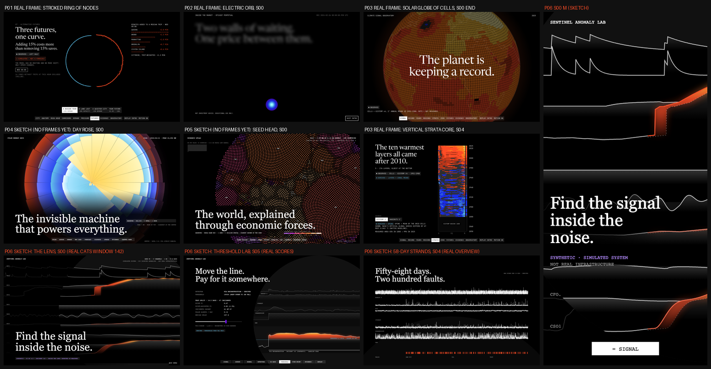

# Visual design: Sentinel Anomaly Lab ("Find the Signal Inside the Noise")

This document covers phases 14-16: reference research, three competing concepts with a scored
selection, and the experience blueprint. The motion bible (phase 17) is `MOTION_SYSTEM.md`.
Author: Creative Director (task P06-CD-001), 2026-10-11.

## Contents

0. [Binding inputs](#0-binding-inputs)
1. [Reference research (phase 14)](#1-reference-research-phase-14)
2. [Three concepts and the selection (phase 15)](#2-three-concepts-and-the-selection-phase-15)
3. [Experience blueprint (phase 16)](#3-experience-blueprint-phase-16)
4. [Signature interactions](#4-signature-interactions)
5. [Copy deck](#5-copy-deck)
6. [Placeholder bindings and data requests](#6-placeholder-bindings-and-data-requests)
7. [Hard rejection criteria](#7-hard-rejection-criteria)

---

## 0. Binding inputs

These are inputs to the design. The design does not choose them.

- **Shared language.** `design/reference-analysis.md`, `design/interaction-inventory.md`, `shared/design-tokens/tokens.css` and `design/fonts/DECISION.md` (workspace root). Fonts: Newsreader (display) and JetBrains Mono (everything else). The ghost-word state is opacity 0.55 plus a 12px blur (ENGINEERING_DECISIONS #10).
- **What other projects own** (`docs/DESIGN_AUDIT.md`, ENGINEERING_DECISIONS #14-#28, and the P04/P05 VISUAL_DESIGN docs). Evidence I opened for this task:
  - P01 `artifacts/evidence/stage-b3/1440x900/06-futures-a-busier.png` (real frame)
  - P02 `artifacts/evidence/stage-a/1440x900/00-s00-t1250.png` (real frame)
  - P03 `artifacts/evidence/stage-a/1440x900/01-s00-t4600-end.png` and `04-s04-p96.png`, plus `sheet-1440x900.png` (real frames; this replaces P05's spec reconstruction of P03, as DESIGN_AUDIT asked)
  - P04 `design/sketches/rose-s00-d.png` and P05 `design/sketches/seed-s00-d.png` (sketches only: neither project has evidence frames yet, and the sheet labels them SKETCH)

  What each project owns:
  - **P01** owns an oversized *stroked* hairline ring with nodes on its circumference, chords inside, a stepping horizon dial, and a rising spectral horizon arc.
  - **P02** owns rectilinear depth walls and a small, smooth Electric glow orb that contracts to a marker.
  - **P03** owns a smooth Solar orb resolving into a sphere of square cells with a limb, an equal-area unwrap, a **vertical core of coloured yearly strata**, and a push into the surface.
  - **P04** owns a filled, area-true 24-petal rose with black spokes and radial band fills.
  - **P05** owns a giant disc of luminous grains on a golden-angle lattice with seamed territories.
  - **P07** (in progress, no design doc in the workspace on 2026-10-11) is planned as an oversized globe-limb arc with nodes travelling its circumference (MASTER_PLAN). Watch item.
- **The plan's P06 geometry is withdrawn.** MASTER_PLAN's "radar sweep over concentric rings, one lane per metric" collides with P01's ring and P04's radial form, and the orchestrator has banned radar, rings and sweeps for P06. A telemetry waterfall survives only as a secondary view, and it must not read like P03's vertical strata core (section 2).
- **Data read on 2026-10-11** from `site/public/data/` (commit `381df44`, "Build status: P06 data passed (CATS v2)"):
  - **Dataset.** CATS v2, Zenodo 8338435, CC BY 4.0. `meta.dataset.nature` = "Simulated complex dynamical system with 200 deliberately injected anomalies; not real telemetry." It has 5,000,000 rows at 1 Hz over 57.87 days (`facts.days`), 17 channels (10 telemetry `b*`/`c*`, 7 context `a*` with no role names), 200 incidents, 13 categories without names, and contamination 3.80%.
  - **Splits.** These are temporal: train 1,000,000 rows (no incidents), gbm_fit 1,500,000 (83), val 1,250,000 (50), and test 1,250,000 (67, 14.47 days).
  - **Detectors on test, at the val-chosen best-event-F1 threshold:**

    | Detector | Tag | Point F1 | Point-adjusted F1 | Inflation | Caught | False alerts / day | Median delay |
    |---|---|---|---|---|---|---|---|
    | PCA | DERIVED | 0.467 | 0.816 | 1.7x | 41 of 67 | 0.14 | 107 s |
    | GBM | PREDICTED | 0.512 | 0.857 | 1.7x | 41 of 67 | 0.41 | 67 s |
    | Change-point | DERIVED | 0.145 | 0.650 | 4.5x | 28 of 67 | 2.70 | 243 s |
    | Robust z | DERIVED | 0.056 | 0.281 | 5.0x | 9 of 67 | 3.25 | 175 s |
    | Isolation Forest | DERIVED | 0.042 | 0.773 | **18.6x** | 28 of 67 | 26.27 | 238.5 s |

  - **Thresholds per detector** (`threshold_sweep.detectors[id].thresholds_q`): robust_z 159, pca 160, iforest 160, changepoint 146, gbm 90. **The lab slider is indexed per detector**, never a fixed 160-step control.
  - **Attribution** is scored only for robust_z and PCA (`meta.detectors[id].has_channel_contributions`). PCA hit@1 is 0.70 on all 200 incidents and 0.64 on test, against a random baseline of 0.10. Per root-cause channel, PCA hit@1 on `bed2` is 0.06 (n 36), while robust z reaches 0.31: PCA's attribution fails on one channel.
  - **Windows.** There are 12 incident windows, all from test, covering categories 1-12 of 13 (category 13 has 4 test incidents but no window, DR-6). Windows 168, 138 and 135 are `truncated: true` (`anomaly_end == n`): the labelled segment runs past the window's end.
  - **The hero window is 142** (category 9, root cause `bfo2`, affected `cso1`, segment 2,000 s, window 2,600 s, not truncated). Measured against `channels.json` train SD, `bfo2` moves 11.7 SD and `cso1` 9.0 SD during the segment, while the other channels stay inside their normal range (bed2's normal sawtooth already spans about 6 SD before the incident). PCA and GBM flag it at 0 s, Isolation Forest at 33 s and change-point at 52 s. **The robust z-score never flags it** (`incidents.json`, best_event_f1). PCA's top 3 contributors are `bfo2, cso1, bso3`. The story of the opening is real: one detector sees it, the simplest one does not.
- **The tagline versus the data.** CATS signals are "provided without noise" (dataset document, quoted in DATA_SOURCES). So "noise" on this site **never means sensor noise**. It means the normal behaviour of a busy system (all 17 channels moving all the time, the 96.2% of seconds that are nominal) and the false alarms a detector raises on it. The S01 copy says this explicitly, and rejection criterion 3 enforces it.
- **Contracts.** `docs/DATA_CONTRACTS.md` plus 12 schemas in `data/contracts/`. Section 6 binds every placeholder to those field names. Anything missing is a numbered data request (DR-n).
- **Honesty rules from the data** (binding on every view):
  1. **SYNTHETIC in the hero area.** `meta.dataset.nature` (uppercased) and a SYNTHETIC chip are on screen from the first frame of S00. Copy never says "server", "production", "infrastructure we monitor", "real telemetry" or "SMD".
  2. **CC BY 4.0 attribution with "changes made".** All three `meta.attribution` strings are in the S08 footer and S02 card 1, and the short form `CATS V2 · SOLENIX ENGINEERING GMBH · CC BY 4.0 · CHANGES MADE` is in every scene footer from S01 on.
  3. **Both F1 variants side by side.** No F1 number appears without its partner. Point-adjusted F1 is never shown alone or larger, and `detector_eval.caveat_point_adjust` is one tap away wherever it appears.
  4. **Thresholds are val-derived.** Every threshold mark carries `CHOSEN ON VAL` (`detector_eval…selected_on`). Test numbers are labelled `TEST`, and val numbers `VAL`.
  5. **The GBM is PREDICTED.** Its strand, chip and numbers carry the `#8FA2FF` PREDICTED tag, and its card says it was trained on 83 labelled incidents (`meta.splits.gbm_fit.segments`).
  6. **Attribution is "contributing measurements, not causes".** The sentence `attribution.wording` sits beside every ranking. The word "cause" appears only inside the quoted dataset column name `root_cause`, set in mono and labelled `DATASET LABEL`.
  7. **Two scopes are never mixed.** Split-level numbers (from `threshold_sweep` and `detector_eval`) are labelled `TEST SPLIT · 14.5 DAYS · 67 INCIDENTS`. Window-level numbers recomputed in the browser are labelled `THIS WINDOW · {{n}} S · RECOMPUTED IN YOUR BROWSER`. One cell never holds both.
  8. **Truncated windows say so.** When a truncated window is shown, the label reads `SEGMENT CONTINUES BEYOND THIS WINDOW ({{incident.duration_s}} S IN TOTAL)`, and window-level recall or delay is never presented as the incident's.
- **Sketches** (original, rendered from the real artifacts by `design/sketches/render_lens_sketch.py`; `uv run --with numpy python design/sketches/render_lens_sketch.py`, then `render_sheet.mjs` and `compose_sheet.py`):
  - `design/sketches/lens-s00-d.png` and `lens-s00-m.png`: the S00 end state, D and M (window 142)
  - `design/sketches/lens-s05-d.png`: S05 threshold lab (window 142, five real score strands, PCA's val threshold)
  - `design/sketches/strands-s04-d.png`: S04, the 58-day strands (real `overview.json`, 200 incident ticks)
  - `design/sketches/distinctness-sheet.png`: the contact-scale comparison against P01-P05 (section 2)
  - **Sketch approximation:** the expected path is the 61 s trailing median (as in METHODOLOGY), but the residual's robust scale is not published, so the sketch uses train SD. The build uses DR-1.
- **What we take from the reference** (principles only, never assets or copy):
  - black stages lit by one luminous form
  - oversized serif statements revealed word by word through blur
  - uppercase mono for all UI and body copy
  - 100dvh sticky stages in long tracks
  - threshold-stepped 1.2s settles
  - 4-segment story cards
  - an argument card stack
  - the square blur bottom nav and the mobile current-section pill
  - a closing that echoes the opening

  We do **not** take its 164vw ring dial. Our circle has no outline and never rotates. It is a lens: a region where the record is magnified and re-read.

### The Lens: encoding (binding)

The giant circular element is **the Lens**: a giant circular region laid over the telemetry record, inside which the record is magnified and shown the way a detector reads it. Outside the lens are raw measurements. Inside it are the expected path, the measured path and, only where a detector raises an alert, the residual between them, lit orange-red. The lens is how "finding the signal" looks: noise outside, the detector's view inside.

| Aspect | Rule |
|---|---|
| **Strand** | One strand per channel, a continuous line. The **10 telemetry channels** are always drawn. The 7 context channels appear only in S02 card 1 and in REPLAY (CONTEXT toggle), as 1px dashed lines at 32% labelled `CONTEXT (COMMAND OR STIMULUS, ROLE NOT ASSIGNED)` (`channels.grouping_note`). Strand order is fixed: `bed1 bed2 bfo1 bfo2 bso1 bso2 bso3 ced1 cfo1 cso1` from the top |
| **Time** | Horizontal at every scale: left is earlier, right is later. **Never vertical, never angular.** One strand never wraps |
| **Level (outside the lens)** | `z = (v - train_mean) / train_std` (`channels.json`), offset so each strand sits on its baseline at the window's pre-incident median. The amplitude is `A_out` px per train SD, **the same for every channel**, so a strand that moves more really moved more against its own normal spread. 1px white at 30% |
| **Inside the lens** | Time is magnified `Mt` x about the lens centre (the **focus second**), and amplitude is `Ma` = 2 x. Each strand is drawn as a ridge: measured path 1.5px white at 85%, with a ridge fill under it from white 20% to 0 over 45% of the strand gap, occluding the strands above it. **Expected path:** the 61 s trailing median (the robust-z detector's own expectation, METHODOLOGY), drawn dotted (2 on, 4 off) white at 50%, only where the channel is lit. The first 60 s of a window have no full median and draw no expected path (`WARMING UP`) |
| **Lit (the residual)** | A channel is lit only where the **active detector's score is at or above its threshold** (`flag = q >= threshold_q`) **and** the channel is in that detector's contribution top 3 for the incident (`incidents[].attribution.{pca,robust_z}.top3`, or per second with DR-4). The lit area is the region between expected and measured paths, filled with the Solar-to-orange gradient (`#FFC23D` at the measured edge, `#FF4C25` at 35%, 5% at the expected edge), plus a soft glow. Intensity by rank: 1.0, 0.75, 0.5. The measured line becomes 2px `#FF4C25` |
| **Detectors without channel contributions** | Isolation Forest, change-point and GBM never light a channel. Their alert shows as a 3px white bar across the lens top, labelled `ALERT · THIS DETECTOR DOES NOT SAY WHICH MEASUREMENT` |
| **Lens body** | A flat glass tint (white at 6.5%) inside the circle. **No stroke, no rim brightening, no gradient toward the edge.** The edge exists only as the change of texture: a discontinuity in every strand, the ridge fills and the tint |
| **Lens geometry** | Section 3.3 (L-states). It is always a perfect circle. Only its centre, radius, `Mt` and focus second change. **It translates and resizes, and never rotates** |
| **Colour** | One alarm hue: `#FF4C25` with the Solar highlight `#FFC23D`, used **only** for lit residuals, labelled incident spans, and caught-incident ticks (plus the shared S07 answer-card fill, which carries black text and no data). Everything else is white or grey |
| **Never** | Any of the following, anywhere, as the giant element: a ring, outline or stroke on the lens; concentric rings or guide circles; a radar or a sweep; angular time; nodes on a circumference; chords; wedges, petals or spokes; square cells; a limb or sphere shading; a smooth glow disc (an orb); a grain or dot lattice; uniform parallel stripes without data (a "synthwave sun"); a horizon grid floor. A channel is never lit without an alert above a val-chosen threshold, and a lit channel is never called a cause |

### Colour semantics (project 06 rule set)

**The accent is kept:** orange-red `#FF4C25` anomalies on white and grey telemetry, as the plan sets. Three reasons:

1. **The alarm is the only light on the page.** Orange appears only where a detector fires or a label exists, so colour itself carries the analysis ("light comes from one luminous form").
2. **It is the program's highest-contrast accent on black** (6.3:1), so it can be text as well as fill.
3. **It does not collide.** P01 pairs orange with light blue on a ring, and P04 uses a peaker ember inside petals. Neither uses orange as the sole hue on line traces.

| Role | Value | Contrast on `#000` | Rule |
|---|---|---|---|
| Raw strands | White 30% (outside), 85% (inside the lens) | decorative / 13.5 | Never coloured by channel. Channel identity is by position and label |
| Alarm (lit residual, labelled span, caught tick) | `#FF4C25`, highlight `#FFC23D` | 6.3 / 13.0 | Only where an alert or a label exists. Never decoration, never a channel's identity colour |
| Missed incident | 1px `#FF4C25` outline, hollow | 6.3 | Labelled span with no flag at the active threshold |
| Threshold hairline and val-derived marks | `#58B8E1` (`--tag-derived`) | 9.4 | Every threshold line, with `CHOSEN ON VAL` |
| PREDICTED (GBM) | `#8FA2FF` (`--tag-predicted`) | 8.8 | GBM chip, its ledger rows, and its strand label |
| SYNTHETIC | `#B48CFF` (`--tag-synthetic`) | 8.1 | The telemetry and label chips, the hero chip |
| **Violet `#690DE2` (fill only)** | | 2.8 | Active parameter blocks (white text, 7.6:1) and the S01 violet notification card. **Never** a line, text, strand or data mark |
| Deep blue `#192CE4` (fill only) | | 2.5 | The S02 "four rooms" card fill only. Never data |
| Text | `#fff`, and `rgba(255,255,255,.5)` at 13px and up | | |

### Uncertainty and honesty grammar

| Kind | Tag | Visual |
|---|---|---|
| Channel values, labels, incident spans, categories | SYNTHETIC | `#B48CFF` chip `SYNTHETIC · SIMULATED SYSTEM`. Labelled spans are 3px white bars under the strands (orange when lit by an alert) |
| Unsupervised scores (robust z, PCA, IF, change-point), thresholds, metrics, attribution ranks | DERIVED | `#58B8E1` chip. Threshold hairlines are light blue |
| GBM scores and its metrics | PREDICTED | `#8FA2FF` chip `PREDICTED · TRAINED ON 83 LABELLED INCIDENTS` |
| Point-adjusted numbers | DERIVED, with a caveat | Always to the right of point-wise numbers, in the same size, with `(×{{inflation}})` and an info toggle that opens `detector_eval.caveat_point_adjust` |
| Event recall on 67 incidents | DERIVED | When shown in S06 and S07, followed by `± ABOUT {{facts.event_recall_ci_halfwidth}} (67 INCIDENTS)` (DR-5) |
| OBSERVED | Never | Nothing on this site is observed from a real system (PROBLEM.md) |

Every visual carries one chip: 13px mono, 8px padding, `#ffffff1a` background, in the tag colour. Where an artifact carries `tags`, **the chip text comes from the artifact**.

**The footer is on every scene from S01 on** (12px mono, 50% white): `CATS V2 · SOLENIX ENGINEERING GMBH / PATRICK FLEITH · CC BY 4.0 · CHANGES MADE · SIMULATED, NOT REAL TELEMETRY`, linking to the full `meta.attribution` text in S08.

---

## 1. Reference research (phase 14)

Each reference was verified on 2026-10-11 by one of these methods:

- **C:** `curl -L` (desktop UA) returned HTTP 200, and the page title was read (quoted). The raw log is `design/reference-check.txt`.
- **R:** the orchestrator's captured reference walk (`design/reference/` at the workspace root).
- **F:** a fact read from a file in this repository.

**The Motion column describes, it does not observe.** Unless the row is marked R, I did not watch the motion in a browser for this task, and the design does not claim it as an observed interaction.

Excluded after checking (not cited):

| URL | Result |
|---|---|
| pudding.cool/2018/08/pop_music/ | 404 |
| docs.datadoghq.com/monitors/types/anomaly/ | HTTP 200, but the served HTML carries no `<title>` or `<h1>` (client-rendered), so I could not confirm its content. It is not cited as evidence; "monitoring product" anti-references rest on #24 |

| # | Reference (URL) | Verified | Technique | Motion (described, not observed, unless R) | Strength for us | Implementation direction | Originality strategy |
|---|---|---|---|---|---|---|---|
| 1 | Blink Capital, https://blink.capital/ | R (curl 200; no `<title>` in the HTML) | 100dvh sticky stages, story cards, chat stack, blur bottom nav, one luminous form | Observed: 1.2s `cubic-bezier(.33,1,.68,1)` stepped settles, word blur reveal, instant nav jumps | The mandatory grammar | Principles only, through the shared shell and tokens | Our luminous form is a lens over line traces. It has no ring, no dial and no rotation |
| 2 | Zenodo, CATS v2, https://zenodo.org/records/8338435 | C ("Controlled Anomalies Time Series (CATS) Dataset \| Zenodo") | The source of record, its licence field and its "simulated" nature | n/a | The honesty frame: simulated, injected, exact labels | Hero chip from `meta.dataset.nature`; S02 card 1; S07 answer 1 | We say "simulated" in the first frame, not in a footnote |
| 3 | Creative Commons, CC BY 4.0, https://creativecommons.org/licenses/by/4.0/ | C ("Deed - Attribution 4.0 International - Creative Commons") | Attribution, licence link, "indicate if changes were made" | n/a | The three attribution obligations | `meta.attribution[0..2]` on screen; footer short form | n/a |
| 4 | Kim et al., "Towards a Rigorous Evaluation of Time-series Anomaly Detection", https://arxiv.org/abs/2109.05257 | C ("[2109.05257] Towards a Rigorous Evaluation of Time-series Anomaly Detection"; abstract: point adjustment "has a great possibility of overestimating", "even a random anomaly score can easily turn into a state-of-the-art" method) | The point-adjust critique | n/a | The core of S06 | S06 "One touch paints the whole fault": the PA flood on a real window | We **show** the inflation as a flood of orange across a labelled span, from 2 real flagged seconds |
| 5 | Tatbul et al., "Precision and Recall for Time Series", https://arxiv.org/abs/1803.03639 | C ("[1803.03639] Precision and Recall for Time Series") | Range-based precision and recall | n/a | Grounds why event-level metrics differ from point-wise ones | S06 protocol toggle POINT / POINT-ADJUSTED / EVENT; S07 answer 2 | Three report cards for the same scores, never one blended score |
| 6 | Wu and Keogh, "Current Time Series Anomaly Detection Benchmarks are Flawed…", https://arxiv.org/abs/2009.13807 | C ("[2009.13807] Current Time Series Anomaly Detection Benchmarks are Flawed and are Creating the Illusion of Progress") | Benchmark flaws, including trivially easy anomalies | n/a | Supports "a simulated benchmark is easier than real life" | S07 answer 1 and LIMITATIONS 1 copy | We volunteer the easiness: exact labels, no noise |
| 7 | Hundman et al., "Detecting Spacecraft Anomalies Using LSTMs and Nonparametric Dynamic Thresholding", https://arxiv.org/abs/1802.04431 | C (title as quoted) | Residual-based detection with thresholding | n/a | Residual = measured minus expected, as the core visual idea | The lens interior: expected path, measured path, residual fill | We use small explainable detectors and say why (METHODOLOGY) |
| 8 | Google SRE Workbook, "Alerting on SLOs", https://sre.google/workbook/alerting-on-slos/ | C ("Google SRE - Prometheus Alerting: Turn SLOs into Alerts"; the page names precision, recall, detection time and reset time) | Alert quality as precision, recall and detection time | n/a | The operator's vocabulary for the lab | S05 ledger: incidents caught, false alerts per day, median delay | A threshold you move with your hand, against a stored record |
| 9 | Google SRE Book, "Monitoring Distributed Systems", https://sre.google/sre-book/monitoring-distributed-systems/ | C ("Google SRE: SRE Responsibilities and Management Frameworks") | Paging only on actionable alerts | n/a | Why false alerts per day is the cost that matters | S01 notification cards; the 1-per-day budget operating point | n/a |
| 10 | Wikipedia, "Alarm fatigue", https://en.wikipedia.org/wiki/Alarm_fatigue | C ("Alarm fatigue - Wikipedia") | Desensitisation from frequent false alarms | n/a | Human stakes of false alerts | S05 statement 2 copy | n/a |
| 11 | Numenta Anomaly Benchmark, https://github.com/numenta/NAB | C ("GitHub - numenta/NAB: The Numenta Anomaly Benchmark · GitHub") | A benchmark scoring that rewards early detection | n/a | Detection delay as a first-class metric | Median delay in every ledger; REPLAY playhead shows the delay as distance | We show delay as a gap you can see between the span start and the first lit second |
| 12 | TimeEval, "Anomaly Detection in Time Series: A Comprehensive Evaluation", https://timeeval.github.io/evaluation-paper/ | C (title as quoted, "Supporting material for the VLDB 2022 paper") | A many-detector comparison | Static result tables | Shows the field compares families, not one model | S03b five detectors side by side, one strand each | Five strands in one lens, never a leaderboard table |
| 13 | ruptures documentation, https://centre-borelli.github.io/ruptures-docs/ | C ("Welcome to ruptures - ruptures") | Offline change-point detection | n/a | Our change-point method's source | S03b card for change-point and its causal delay note (LIMITATIONS 8) | n/a |
| 14 | scikit-learn, `IsolationForest`, https://scikit-learn.org/stable/modules/generated/sklearn.ensemble.IsolationForest.html | C (title "IsolationForest", scikit-learn 1.9.1 documentation) | Isolation-based scores | n/a | Method naming | S03b, S07 answer 7 | n/a |
| 15 | scikit-learn, `HistGradientBoostingClassifier`, https://scikit-learn.org/stable/modules/generated/sklearn.ensemble.HistGradientBoostingClassifier.html | C (title "HistGradientBoostingClassifier", scikit-learn 1.9.1 documentation) | The supervised detector | n/a | Method naming, the PREDICTED tag | S03b GBM card | n/a |
| 16 | scikit-learn, `PCA`, https://scikit-learn.org/stable/modules/generated/sklearn.decomposition.PCA.html | C (title "PCA", scikit-learn 1.9.1 documentation) | Reconstruction error | n/a | The best detector here, and an attribution source | S03b, S06 part 2 | n/a |
| 17 | Wikipedia, "Median absolute deviation", https://en.wikipedia.org/wiki/Median_absolute_deviation | C ("Median absolute deviation - Wikipedia") | The robust scale behind robust z | n/a | Explains "1.4826 × MAD" | S03a kicker; DR-1 | n/a |
| 18 | Wikipedia, "Precision and recall", https://en.wikipedia.org/wiki/Precision_and_recall | C ("Precision and recall - Wikipedia") | Definitions | n/a | Shared vocabulary | S05 definitions toggle | n/a |
| 19 | Wikipedia, "Receiver operating characteristic", https://en.wikipedia.org/wiki/Receiver_operating_characteristic | C ("Receiver operating characteristic - Wikipedia") | Threshold trade-off curves | n/a | **Anti-template.** The textbook move is a PR or ROC curve with axes and a grid | Our trade-off is a hairline you move inside the lens, with the cost read in a ledger and on the 14.5-day strip. The PR curve appears once, as a small card mini-visual in S07 answer 2 | Never a full-scene curve chart |
| 20 | Wikipedia, "Loupe", https://en.wikipedia.org/wiki/Loupe | C ("Loupe - Wikipedia") | A hand magnifier for close inspection | n/a | The metaphor and the name of the form | The lens itself | A data lens that also changes the reading (expected vs measured), not only the scale |
| 21 | Mike Bostock, "Fisheye Distortion", https://bost.ocks.org/mike/fisheye/ | C ("Fisheye Distortion") | Focus + context distortion | Described: pointer-driven local magnification | The proven interaction pattern for magnifying part of a dense record in context | The lens's time magnification about the focus second, with the raw context outside | Our magnification is uniform inside a hard circle (honest scale, printed `×{{Mt}}`), never a smooth fisheye that warps distances |
| 22 | Wikipedia, "Fisheye view" (resolves to "Fisheye lens - Wikipedia"), https://en.wikipedia.org/wiki/Fisheye_view | C ("Fisheye lens - Wikipedia") | Optical wide-angle distortion | n/a | **Anti-reference** for the inside of the lens | No barrel distortion; strands inside are straight-scaled | n/a |
| 23 | Wikipedia, "Oscilloscope", https://en.wikipedia.org/wiki/Oscilloscope | C ("Oscilloscope - Wikipedia") | Bright traces on black, a trigger level | Described: traces sweep across the screen | Line traces as light; a trigger is a threshold | The strand look; the threshold hairline | **No round CRT bezel, graticule grid or phosphor green.** No sweep animation |
| 24 | Grafana Labs, https://grafana.com/ | C ("Full-stack observability for the agentic era \| Grafana Labs") | The monitoring dashboard archetype: panel grids, time-series panels with axes, legends, red threshold bands | n/a | **Anti-reference.** What "a standard monitoring dashboard" looks like | Rejection criterion 1: no panel grid, no axes with gridlines, no legend boxes, no stat tiles | One lens, one story per viewport |
| 25 | Chart.js, "Line Chart", https://www.chartjs.org/docs/latest/charts/line.html | C ("Line Chart \| Chart.js") | A library line chart: gridlines, axes, legend, tooltips | Default animate-in | **Anti-reference** for every strand | Rejection criterion 1 | Strands are ridges inside a lens with direct mono labels |
| 26 | Wikipedia, "Unknown Pleasures", https://en.wikipedia.org/wiki/Unknown_Pleasures | C ("Unknown Pleasures - Wikipedia") | The stacked-ridgeline cover drawn from a pulsar plot | n/a | Stacked occluding ridges read as one luminous object | The ridge fills inside the lens | **Anti-copy.** We never draw a centred stack of equal ridges on a square; ridges exist only inside the lens, carry real channels, and are labelled |
| 27 | Wikipedia, "PSR B1919+21", https://en.wikipedia.org/wiki/PSR_B1919%2B21 | C ("PSR B1919+21 - Wikipedia") | The pulsar whose successive pulses formed that plot | n/a | Successive traces of one source | Lineage for #26 | n/a |
| 28 | Wikipedia, "Seismogram", https://en.wikipedia.org/wiki/Seismogram | C ("Seismogram - Wikipedia") | Long-duration traces where events stand out of background motion | Described: a drum recorder | The S04 58-day strands read as a record, not a chart | `strands-s04-d.png`: five detector traces across 58 days | **No rotating drum** (rotation is banned), no paper texture |
| 29 | Wikipedia, "Synthwave", https://en.wikipedia.org/wiki/Synthwave | C ("Synthwave - Wikipedia") | The striped-sun-over-grid visual cliché of the genre | n/a | **Anti-reference.** A circle filled with horizontal lines can read as a striped sun | Rejection criterion 2: stripes must be real, labelled, non-uniform strands; no gradient sun palette; no grid floor | Ours is white line traces with one orange residual |
| 30 | Wikipedia, "Signal-to-noise ratio", https://en.wikipedia.org/wiki/Signal-to-noise_ratio | C ("Signal-to-noise ratio - Wikipedia") | The engineering meaning of "noise" | n/a | Why the tagline must be defined for this data (CATS has no sensor noise) | S01 kicker definition of noise | n/a |
| 31 | Wikipedia, "Isolation forest", https://en.wikipedia.org/wiki/Isolation_forest | C ("Isolation forest - Wikipedia") | Point outliers in feature space | n/a | Why IF is weak on contextual anomalies here (LIMITATIONS 10) | S07 answer 7 | n/a |
| 32 | Wikipedia, "Change detection", https://en.wikipedia.org/wiki/Change_detection | C ("Change detection - Wikipedia") | Detecting shifts in a series | n/a | Vocabulary for S03b | Change-point card | n/a |
| 33 | OmniAnomaly (SMD), https://github.com/NetManAIOps/OmniAnomaly | C (title quoted in `reference-check.txt`) | The planned dataset with interpretation labels | n/a | **Rejected source.** No dataset licence (DATA_SOURCES) | S07 answer 1 explains the switch | Never named as our data |
| 34 | Wikipedia, "Gravitational lens", https://en.wikipedia.org/wiki/Gravitational_lens | C ("Gravitational lens - Wikipedia") | A circular region that bends what passes behind it | n/a | The strand discontinuity at the edge reads as refraction | Lens edge = discontinuity, never a stroke | No Einstein-ring arcs (rings banned) |
| 35 | MDN, `CanvasRenderingContext2D.clip()`, https://developer.mozilla.org/en-US/docs/Web/API/CanvasRenderingContext2D/clip | C ("CanvasRenderingContext2D: clip() method - Web APIs \| MDN") | A circular clip path | n/a | The whole lens is two passes: outside (inverse clip) and inside (circle clip) | MOTION_SYSTEM 9.1 | n/a |
| 36 | MDN, `createLinearGradient()`, https://developer.mozilla.org/en-US/docs/Web/API/CanvasRenderingContext2D/createLinearGradient | C ("CanvasRenderingContext2D: createLinearGradient() method - Web APIs \| MDN") | Gradient fills | n/a | Ridge fills and the residual's Solar-to-orange gradient | MOTION_SYSTEM 9.1 | n/a |
| 37 | Lenis, https://lenis.darkroom.engineering/ | C ("Lenis – Smooth Scroll") | Normalized smooth scroll | Inertial scroll | The reference's own smoothing | The shared shell's one progress loop | n/a |
| 38 | Igloo Inc (Awwwards SOTD), https://www.awwwards.com/sites/igloo-inc | C ("Igloo Inc - Awwwards SOTD") | A cinematic intro handing off to scroll | Described | Intro pacing | The 4.6s skippable "Focus", whose end state is the S01 start | Our intro is a detector reading a record, not a camera flight |

---

## 2. Three concepts and the selection (phase 15)

All three use the shared family:

- black stages, Newsreader statements, mono UI
- sticky stages in tracks
- story cards and an argument stack
- the bottom blur nav and a closing echo

What differs is the metaphor, the giant circular composition, the scene composition and the closing.

**The distinctness constraint I designed against:**

| Project | Owns (do not touch) | Texture | Edge |
|---|---|---|---|
| P01 | A 164vw stroked ring with nodes, chords, a stepping horizon dial, a rising spectral arc | Hairline + points | A stroke |
| P02 | Rectilinear depth walls; a small Electric orb that shrinks to a marker | Smooth glow | Soft falloff |
| P03 | A Solar orb into a sphere of square cells with a limb; an equal-area unwrap; a vertical core of coloured strata | Square cells; horizontal colour bands in a vertical column | Limb shading |
| P04 | A filled 24-petal rose with spokes | Solid wedges | Petal tips |
| P05 | A grain disc on a golden-angle lattice with territories | Dots | Ragged grain spiral |
| P07 (planned) | A globe-limb arc with travelling nodes | Arc + nodes | A limb |
| Banned for P06 | Radar, rings, sweeps | | |

**What is left is the continuous line**, which is also what telemetry is. Each concept therefore names its texture, its edge, its motion, and **what physically breaks** when an anomaly appears.

**Two development iterations** (rendered from real data; PNGs kept as the current sketches):

1. **Residual-threshold lighting** (a channel lit wherever `|measured − expected|` exceeded 3 train SD). It lit `bed2`'s normal sawtooth in window 142 as if it were the fault: **the lens was lying about noise**. Lighting is now tied to a real detector alert above a val-chosen threshold, plus that detector's contribution ranking (section 0).
2. **An off-centre M lens at 2.6x magnification** had the window's data start inside the circle, so the lens showed a vertical edge and no arc. The M geometry (3.3) now keeps an arc visible and clamps the focus so data always spans the lens chord. A lens without a glass tint read only through strand breaks at contact scale; the 6.5% tint was added.

### Concept A: "The Lens"

- **Philosophy.** A busy system is a record of 17 measurements that never sit still, and almost none of that movement is a fault. A detector is a way of looking: hold a lens over the record and it shows what was expected, what happened, and, only when it is confident enough to alert, the difference.
  - Move the lens along the record and you read it.
  - Swap the detector and the lens reads it differently.
  - Move the threshold and you decide when the lens is allowed to light, and you pay for it in missed faults or false alarms.
  - Change how the result is graded and the same lens earns a different score.
- **Texture:** horizontal line traces, ridges inside the lens. **Edge:** a discontinuity in every trace plus a flat glass tint, never a stroke. **Motion:** translation along time, focus (magnification) and ignition. **What breaks:** one trace's measured path pulls away from its expected path, and the gap fills with light.
- **Signature geometry.** The **Lens** (section 0), plus two companions:
  - the **58-day strands:** five detector traces across the whole record, with 200 incident ticks (S04)
  - the **paint:** the point-adjust flood across a labelled span (S06)
- **Accent use.** Orange-red only for lit residuals, labelled spans and caught ticks; light blue for val-derived thresholds; violet fills active controls.
- **Layout.** Asymmetric editorial: statements on a left measure, the lens centre-right and partly off-frame. REPLAY mirrors it (lens left, rail right).
- **3D/2D strategy.** Canvas2D (one canvas, two clip passes per frame), DOM for text and controls. No WebGL, no chart library (MOTION_SYSTEM 9.1).
- **Hero concept.** Black. Ten white traces write themselves across the screen, a record of a simulated machine. A giant circle of glass comes into focus over the right of the record: inside it the traces stretch and gain their expected paths. Then one trace, `bfo2`, pulls away from where it should be, and the gap fills with orange light; `cso1` follows. "Find the signal inside the noise." The chip under it reads SIMULATED SYSTEM, NOT REAL TELEMETRY.
- **Nav labels.** SIGNAL · SOURCE · NORMAL · DETECTORS · 58 DAYS · THRESHOLD · FINE PRINT · EVIDENCE · REPLAY
- **Responsive approach.**
  - D: the lens is centre-right.
  - T: the lens is centred low-right, with arcs visible top-left and bottom-left.
  - M: the lens covers the right of the frame, with its bottom-left arc visible.
  - The lens is always drawn from parameters (centre, R, `Mt`, focus), never scaled as a bitmap.

### Concept B: "The Eclipse"

- **Philosophy.** The detector's model of normal is a black disc that hides everything it can predict. What it cannot predict leaks around and through it as light.
- **Signature geometry.** A giant black disc over the traces; traces pass behind it, and residual light escapes as a corona at the limb.
- **Hero concept.** Traces vanish behind the dark disc; one escapes as a flare.
- **Nav labels.** UMBRA · SOURCE · NORMAL · MODELS · 58 DAYS · THRESHOLD · FINE PRINT · EVIDENCE · REPLAY
- **Strength.** The metaphor of "subtract the expected" is strong.
- **Weaknesses.**
  - The corona is a luminous ring and the disc edge is a limb: P01 and P03/P07 at contact scale.
  - It hides data by design. A black disc that occludes measurements is an honesty smell, and the occluded part cannot be inspected.
  - Five detectors would need five different discs, which fragments the one luminous form.

### Concept C: "The Phase Portrait"

- **Philosophy.** CATS is a dynamical system, so normal operation traces a closed path in state space (an attractor). An anomaly is the system leaving its path.
- **Signature geometry.** A giant circular field showing the state projected on two principal components; normal seconds draw a luminous looping filament, and anomalous seconds escape it.
- **Hero concept.** A filament winds into its loop, then one excursion flies out in orange.
- **Nav labels.** ORBIT · SOURCE · NORMAL · DETECTORS · 58 DAYS · THRESHOLD · FINE PRINT · EVIDENCE · REPLAY
- **Weaknesses.**
  - A closed loop inside a circle reads as **rings** (banned), and the boundary of "normal" would be a stroked circle (P01).
  - It needs a new artifact (per-second PCA projections) and explains only the PCA detector.
  - The axes are abstract components. Operators cannot read them, so analytical clarity is poor.
  - On mobile, a dense filament is unreadable.

### Scores (1 = poor, 5 = excellent)

| Criterion | A The Lens | B The Eclipse | C The Phase Portrait |
|---|---|---|---|
| Fidelity to the reference language (one luminous form, statements, cards, stack, stepped settles, closing echo) | 5 | 4 | 3 |
| Analytical clarity (expected vs measured, five detectors, threshold trade-off, protocols, attribution, delay) | 5 | 3 | 2 |
| **Distinct from P01-P05** (and P07's planned limb arc), checked on the contact sheet | 5 | 2 | 2 |
| **Never reads as a standard monitoring dashboard or charting library** | 4 | 4 | 3 |
| Feasibility on static Pages (Lighthouse 90+, 60fps D / 30fps M) | 5 | 4 | 3 |
| Data honesty (lit only by real alerts, val thresholds, both F1s, SYNTHETIC, no causes) | 5 | 3 | 3 |
| Mobile quality | 4 | 3 | 2 |
| Memorability | 4 | 4 | 4 |
| **Total (of 40)** | **37** | **27** | **22** |

**Why A gets 5 for distinctness.** Here is A checked against every owner, at contact-sheet scale (240px-tall tiles, ENGINEERING_DECISIONS #17), in `design/sketches/distinctness-sheet.png`. The sheet holds real frames for P01, P02 and P03 (S00 end, and the S04 strata core), the P04 and P05 sketches, and three P06 sketches plus P06 M, all from real CATS artifacts.

1. **Not P01.** P01 is a hairline stroke at constant radius with nodes. A has no stroke, no nodes and no chords. Its edge is where ten horizontal traces change texture.
2. **Not P02.** P02 is a small, smooth blue glow. A is giant from its first frame, made of line traces, and never shrinks to a marker.
3. **Not P03.** P03 is a smooth Solar disc of square cells with a limb, and a vertical column of coloured strata. A has no cells, no limb and no shading. Its traces are white lines, and its only colour is one orange residual. **The secondary view also reads differently.** At contact scale, P03's core is a vertical column of horizontal colour bands (time runs up). P06's 58-day view is five thin white traces across the full width (time runs right), with orange ticks under them.
4. **Not P04.** There are no wedges, spokes, petals or radial fills: nothing in A is radial.
5. **Not P05.** There are no dots or grains: every mark in A is a continuous line.
6. **Planned P07.** There is no limb arc and no travelling node. The lens translates along time; nothing travels along its circumference.

**Why A gets 4, not 5, for "never a dashboard or chart".** Telemetry traces are line charts by nature, and a strand with a threshold hairline is the core of every monitoring panel (references 24, 25). Section 7 fences it: no axes, no gridlines, no panel grid, no legend box, no stat tiles; one lens per viewport; strands carry direct mono labels; the threshold exists only inside the lens and on the 14.5-day strip.

**Why A gets 4 for mobile.** At M, the lens must be at least 1.2 x the frame height (507px radius on 844px), which leaves only a bottom-left arc visible, and it crosses behind the MENU pill. The arc is legible in `lens-s00-m.png`, but it is the main M risk (rejection criterion 17).

**Known contact-scale risk.** The lens's 6.5% glass tint is subtle by design (it must never become an orb). At 240px, the circle reads from the strand discontinuity on the left arc plus the ridge fills. If the QA sheet shows the circle is not identifiable at D, the fix order is: ridge fill to 24%, then glass to 8%. **Never add a stroke.**

### Selection: A, "The Lens", with two grafts

A is the only concept where the giant circular element *is* the analytical instrument. A detector's reading (expected, measured, residual, alert) happens inside the circle, and the visitor's parameters (which detector, which threshold, which grading, where in time) all change what the lens shows.

- **From B, "subtract the expected" as a visible act.** In S03a, the VIEW control steps RAW → EXPECTED → RESIDUAL inside the lens. At RESIDUAL, nominal traces flatten to their baselines (the expected is subtracted) and only real departures remain. This keeps B's best idea without hiding any data, because the outside of the lens keeps the raw record.
- **From C, "leaving normal" at card scale only.** S02 card 1's visual zone shows `bfo2` against `cso1` for window 142 as a small trajectory (a phase plot, 1px white, with the labelled span in orange). It is a card-scale mini-visual, never the giant form, and never closed into a ring.

**Departures from MASTER_PLAN.**

- "A radar sweep over concentric rings, one lane per metric" is replaced by the Lens. The one-lane-per-metric idea survives as one strand per channel. The "diverging signal breaks out of its ring" survives as the residual pulling away from its expected path.
- "A WebGL telemetry waterfall in which one signal diverges" becomes horizontal Canvas2D strands (a WebGL waterfall would be a vertical colour stack, too close to P03's core). The 58-day strands are the waterfall's role, re-read as a record.
- "Incident replay" and "a threshold lab that recomputes metrics live from real stored scores" are kept exactly (REPLAY, S05).
- The data change from SMD to CATS (ENGINEERING_DECISIONS #29) is carried into every copy line: simulated, injected, not real infrastructure.

---

## 3. Experience blueprint (phase 16)

### 3.1 Chapter-to-scene map

| Scene | Directive chapter | Nav label | Track | Kind |
|---|---|---|---|---|
| S00 Opening | Find the signal (intro) | (none, overlay) | 0 (fixed overlay, 4.6s or less) | Timed intro, skippable |
| S01 Big Idea | Noise is normal; alarms cost | SIGNAL | 200vh | Scrubbed blur reveal; the lens moves aside |
| S02 Origin of the Data | A simulated machine, 200 injected faults | SOURCE | 300vh | Story-card deck |
| S03a Mechanism I | Normal has a shape | NORMAL | 250vh | Scrubbed lens travel along window 142; 3 stepped VIEW states |
| S03b Mechanism II | Five ways to be suspicious | DETECTORS | 250vh | 5 stepped detector states in the lens |
| S04 Transformation | Fifty-eight days, two hundred faults | 58 DAYS | 300vh | Scrubbed time pull-back from seconds to days; 3 stepped operating points |
| S05 Experiment | Move the line | THRESHOLD | 250vh (stage pinned until 1) | The threshold lab |
| S06 Consequences | The fine print | FINE PRINT | 300vh | Part 1: protocols and the paint. Part 2: which measurements moved |
| S07 Evidence | How we know | EVIDENCE | 250vh | Argument card stack, 7 exchanges |
| REPLAY | Incident replay | REPLAY | 100dvh minimum, **not pinned**, normal flow | Free exploration of 12 windows |
| S08 Conclusion | The signal, found again (echoes S00) | (none; the nav keeps REPLAY active) | 200vh | The lens returns to giant and refocuses with the visitor's settings |

The total is about 2,300vh. If the QA scroll recording shows fatigue, cut S06 to 250vh first, then S02 to 250vh.

### 3.2 Global layout constants

- **Viewports:** D = 1440x900, T = 768x1024, M = 390x844.
- **Grid:**
  - D: 12 columns, 96px side margins, text column x 96-560.
  - T: 8 columns, 48px margins.
  - M: 4 columns, 16px margins.
- **Nav:** a bottom bar 12px from the bottom on D. On T/M, a 160x32 MENU pill at the bottom centre, plus SKIP INTRO / REPLAY INTRO at the bottom right.
- **Safe zone:** nothing interactive within 64px of the bottom on D, or 72px on T/M.
- **One Canvas2D canvas** (fixed, viewport-sized, DPR-capped) draws the strands, the lens and the 58-day strip in every scene from parameters.
  - The DOM holds all text, labels and controls. Channel labels are DOM (11px mono at 50%), positioned from the same geometry.
  - The S07 card mini-visuals are small inline SVGs.
- **Strand baselines.** In a lens scene, the 10 telemetry baselines are spaced evenly across the strand band (D y 96-804, T y 120-900, M y 72-760). `A_out` = 0.075 x the strand gap per train SD (D: 5.9px per SD); `Ma` = 2. A strand that exceeds its band is not clipped (an 11.7 SD departure is the story), but the lens ridge fill occludes the strands above it.
- **Decimation.** Each strand draws at most 2 points per device-pixel column (min and max of the seconds in that column), so a 2,600 s window and a 58-day record draw the same number of segments.

### 3.3 Geometry states (exact)

`c` = lens centre in CSS px, `R` = radius, `Mt` = time magnification inside the lens relative to the outside scale, `f` = focus second (the window second under `c.x`). Outside, the window's `n` seconds span the full viewport width.

| State | D 1440x900 | T 768x1024 | M 390x844 | Notes |
|---|---|---|---|---|
| **L0 Giant** (S00, S08 echo) | c (1010, 450), **R 560** (diameter 1.24 x frame height), `Mt` 3, f = segment start + 160. The left arc is visible from y 90 to 810 at x 450-560 | c (560, 520), R 620 (1.21 x). Arcs visible top-left (0, 254) to (222, 0) and bottom-left (0, 786) to (199, 1024) | c (410, 330), **R 507** (1.20 x), `Mt` 6. The bottom-left arc is visible from (0, 628) down to about (330, 836); it passes behind the MENU pill | **Diameter at least 1.2 x the frame height on every viewport, centre off-frame-centre, and part of the edge visible outside every scrim.** Sketches: `lens-s00-d.png`, `lens-s00-m.png` |
| L1 Aside (S01 end, S02 backdrop at 20%) | c (1110, 470), R 400 | c (384, 760), R 330 | c (195, 640), R 230 | |
| L2 Normal (S03a) | c (980, 460), R 470 | c (384, 620), R 380 | c (195, 460), R 290 | `Mt` is visitor-set: 1, 3 or 10 (ZOOM) |
| L3 Detectors (S03b) | c (1000, 470), R 470 | c (384, 620), R 380 | c (195, 460), R 290 | Inside, the strands are the 5 detector score traces of window 142 |
| L4 Days (S04) | c (1090, 520), R 330 over the 58-day strip | c (384, 700), R 260 | c (195, 560), R 190 | Inside: the 10-minute bins around the focus day at `Mt` 6. The visitor drags the lens along the strip |
| L5 Lab (S05) | c (1110, 540), R 540 | c (384, 660), R 400 | c (195, 380), R 280 | Sketch `lens-s05-d.png` |
| L6 Fine print (S06) | c (1040, 480), R 440 | c (384, 640), R 360 | c (195, 420), R 260 | |
| L7 Replay (REPLAY) | c (560, 470), R 380 | c (384, 400), R 330 | c (195, 330), R 250 | The focus follows the playhead |

- **Interpolation.** Between states, `c` interpolates linearly, and `R` and `Mt` in **log space**. These are camera moves on the lens; they never animate data.
- **Focus clamp.** `f` is clamped so the lens's visible span `2R / (px_per_s × Mt)` stays inside `[0, n)`, so data always fills the lens chord (iteration 2).
- **Contact-scale legibility.** At L0, the luminance step between the inside (glass + ridges) and the outside is checked in QA evidence (MOTION_SYSTEM test 15).

### 3.4 Scenes

Each scene lists: track, compositions (D/T/M), data, insight, honesty tags, interactions, transition out, and states.

**Shared state UI** (every data-backed scene):

- **Initial:** strand baselines as 1px white at 10% (the honest shape of "a record, not yet loaded"). Headings are sharp.
- **Loading:** the mono line `LOADING WINDOW_142 · 42%`. The percentage is real (bytes read / Content-Length). With no length it reads `LOADING WINDOW_142` with no %.
- **Error:** `COULD NOT LOAD WINDOW_142 (HTTP 404)` plus a `RETRY` square button that re-runs the same fetch. A schema-guard failure reads `WINDOW_142 FAILED ITS CHECKS`, also with RETRY.
- **Empty:** scene-specific copy, never a blank canvas.
- **Ready:** normal render.
- **Disabled:** a control that cannot apply (for example ATTRIBUTION on Isolation Forest) is `aria-disabled` and 50% white, with a tooltip giving the reason.
- **Reset:** scene-specific (below).

There are no spinners and no artificial delays.

#### S00 Opening: find the signal (overlay, 4.6s or less)

- **Composition.** Pure black. The timeline is in MOTION_SYSTEM 5.1:
  1. The corner labels appear.
  2. **The record writes:** 10 strands of window 142 ink on from left to right.
  3. **The lens focuses** at full L0 size: glass, magnification and ridges.
  4. Expected paths appear inside the lens.
  5. **Ignition:** where PCA crosses its val threshold, `bfo2`, `cso1` and `bso3` light by rank.
  6. The headline sharpens and the nav enters.

  Layer order is canvas, then scrim, then h1. The scrim is at full strength from frame 0, so the ghost headline is AA from first paint.
- **Data:** `window_142.json` (all 10 telemetry channels, PCA scores), `channels.json`, `incidents.json` (id 142: PCA top3, delay), `detector_eval` (PCA best_event_f1 `threshold_q`), `meta`, `facts`, and DR-1 for the expected path's robust scale. If DR-7 (the hero slice) exists, it replaces `window_142.json` here.
- **Per viewport.**
  - **D:** the headline is left-aligned at x 96, 2 lines at 88px (y 620-790), over a left-to-right scrim (x 0-1040, y 560-830, black 92% to 0). The lens is at L0. Sketch `lens-s00-d.png`.
  - **T:** 64px, 3 lines at x 48, y 420-620, over a scrim band that leaves both left arcs clear.
  - **M:** 40px, 3 lines at y 430-560 (36px if the first line would exceed 358px), over a scrim band y 380-620. The chip lines sit at y 590 and 606. The bottom-left arc stays visible (sketch `lens-s00-m.png`).
- **Corner labels.**
  - Top-left: the mono wordmark `SENTINEL ANOMALY LAB` (13px).
  - Top-right, line 1: `CATS V2 · {{facts.channels}} CHANNELS · 1 HZ · {{facts.days|d1}} DAYS`.
  - Top-right, line 2 (50%): `meta.dataset.nature`, uppercased.
- **Bottom-left chip** (`#B48CFF`): `SYNTHETIC · CC BY 4.0 · INCIDENT {{id}} · INSIDE THE LENS: EXPECTED VS MEASURED`. Under it, after ignition, the 11px line `LIT: PCA ALERT ABOVE ITS VAL THRESHOLD · TOP 3 CONTRIBUTING MEASUREMENTS, NOT CAUSES`.
- **LCP rule.** `h1[data-hero]` is in the DOM from first paint as ghost text (opacity 0.55, blur 12px), never at opacity 0.
- **Insight.** Ten measurements move all the time; read the right way, one of them is clearly not behaving.
- **Interactions.**
  - SKIP INTRO is visible from 0ms. Esc, or any wheel, touch or key scroll, completes the intro in 350ms.
  - It plays once per session (`sessionStorage`, in try/catch). REPLAY INTRO is in the nav and in S08.
- **Transition to S01.** None: the S00 end state is the S01 start state.
- **States.**
  - If window 142 is not ready by 1.2s, the baselines hold (10%), the headline sharpens alone, and the record writes when the data arrives (if within 6s; otherwise the end state fades in over 350ms).
  - If it fails, the baselines stay with `COULD NOT LOAD WINDOW_142 (…) · RETRY`. **No strand is ever drawn without data, and nothing is lit without an alert.**

#### S01 Big Idea: noise is normal, alarms cost (200vh)

| p | Change |
|---|---|
| 0-0.4 | Scrubbed. The headline scales from 88px to 44px and moves to y 96 (D). The lens moves **L0 to L1**, and the scrim fades out |
| 0.35-0.75 | Statement 2 blur-reveals: 64px in the left column (D), 48px (T), 36px (M), with the noise-definition kicker under it |
| 0.6-1 | Two notification cards type in |

- **Notification cards** (radius 8, padding 24; 13px mono header at 50%, 18px body):
  - **Card 1** (`#161616`): header `FROM: PCA DETECTOR / TEST SPLIT · {{facts.test_days|d1}} DAYS`, body `CAUGHT {{pca.best_event_f1.test.detected}} OF {{split.test.segments}} INJECTED FAULTS · {{pca…false_alerts_per_day|d2}} FALSE ALERTS A DAY.` Tag DERIVED.
  - **Card 2** (`#690DE2` fill, white text): header `FROM: ISOLATION FOREST / SAME TEST SPLIT`, body `POINT-ADJUSTED F1 {{iforest…point_adjusted_f1|d2}}. POINT F1 {{iforest…point_f1|d2}}. SAME ALERTS, {{inflation|d1}}X APART.` Tag DERIVED.
- **Placement.**
  - D: the cards sit at x 96-456, y 560-780, left of the lens and never over it.
  - T: full width minus 96, under the statement.
  - M: stacked above the lens, one-line bodies.
- **Data:** `facts.json`, `detector_eval.json`.
- **Insight.** A detector's worth is measured in faults caught against alarms raised, and the way you count can change the answer by 18x.
- **Interactions.** Scroll only. The cards are not buttons. Hovering a strand gives the measurement inspector (interaction 9, tooltip only).
- **Transition to S02.** The lens dims to 20% and holds at L1 as the deck's backdrop.
- **States.** If `detector_eval` is missing, card 2 is dropped.

#### S02 Origin of the Data: a simulated machine (300vh)

- **Composition.** A horizontal story deck driven by vertical scroll (shared component).
  - D: cards 360x620, 8px gap, the active card centred at x 720.
  - T: cards 320x600, neighbours peeking 24px.
  - M: cards 300x560, neighbours peeking 12px.
- **Card anatomy:**
  - radius 8, padding 24
  - a chip (`SOURCE 0n · ...`)
  - a 4-segment progress bar
  - the serif title (40 / 32 / 28px)
  - a visual zone
  - a mono body (18 / 15 / 14px)
  - the tag at the bottom-left

| # | Fill | Visual zone | Data | Tag |
|---|---|---|---|---|
| 1 "A simulated machine." | `#161616` | Window 142: 17 small strands (10 telemetry solid, 7 context dashed and labelled CONTEXT), plus the graft from C: `bfo2` against `cso1` as a 1px white trajectory, with the labelled span in orange. Under it, the three `meta.attribution` strings in 11px | `channels`, `window_142`, `meta.dataset`, `meta.attribution` | SYNTHETIC |
| 2 "Two hundred injected faults." | `#161616` | A 57.9-day strip: 200 orange ticks at `overview.incident_bins` (bin index), with the 13 category numbers as a row of counts (`1: 11 … 13: 12`, from `incidents.json`). Readout `{{facts.contamination_pct|d1}}% OF SECONDS LABELLED · MEDIAN FAULT {{facts.median_incident_duration_s}} S · CATEGORIES UNNAMED IN THE DATASET` | `overview.incident_bins`, `incidents`, `facts` | SYNTHETIC |
| 3 "Four rooms, one direction." | `#192CE4` fill, white text | Four horizontal bands in time order: TRAIN 11.6 d (0 faults), GBM FIT 17.4 d (83), VAL 14.5 d (50), TEST 14.5 d (67), with an arrow `THRESHOLDS ARE CHOSEN HERE` under VAL and `REPORTED HERE, NEVER TUNED` under TEST | `meta.splits` | DERIVED |
| 4 "Checked, not trusted." | `#161616` | 22 square check marks (`quality.checks`, ✓ or ✗ drawn from `passed`), then the label line `200 SEGMENTS FROM LABELS = 200 IN METADATA · 0 MISMATCHED ROWS · END TIME EXCLUSIVE`, and the md5 of `data.parquet` truncated to 12 characters | `quality`, `reconciliation` | DERIVED |

- **Footer** of card 4: `PIPELINE v{{meta.pipeline_version}} · GENERATED {{meta.generated_at|date}}`.
- **Insight.** A simulated system with exact labels makes the comparison fair, and also easier than real life. The splits run forward in time, and every check passed.
- **Interactions.** The progress segments are a `role="tablist"`. Arrow keys jump to that card's position on the track.
- **Transition to S03a.** The last card slides off left while the lens moves L1 to L2, brightens from 20% to 100%, and the record re-writes at window 142's start.
- **States.** A missing artifact shows `UNAVAILABLE` plus RETRY on its card only. A ✗ mark in card 4 is drawn as it is, never hidden.

#### S03a Mechanism I: normal has a shape (250vh)

- **Composition.**
  - **D:** lens at L2 (c 980, 460) over window 142. Left column x 96-560:
    - the serif statement (64px) and the mono kicker
    - **VIEW:** RAW / EXPECTED / RESIDUAL (segmented)
    - **ZOOM:** ×1 / ×3 / ×10 (segmented, sets `Mt`)
    - **CHANNEL:** a listbox of the 10 telemetry channels (default none). The chosen channel's strand is raised to 100% and labelled with its train mean and SD
    - **Readout** at y 420-560: `SECOND {{f}} OF {{n}}`, `{{channel}}: {{z|d1}} SD FROM ITS TRAIN MEAN · {{zres|d1}} ROBUST UNITS FROM EXPECTED`, and `LABELLED: {{yes/no}}`
  - **T:** statement and controls at the top (y 72-300), lens at L2-T, readout in 2 columns under it.
  - **M:** statement (32px) at the top, lens at L2-M, readout as 2 lines, and the controls in one bottom row above the MENU pill (`RAW|EXP|RES`, `×1|×3|×10`).
- **Behaviour.**

| p | State |
|---|---|
| 0.04-0.92 | Scrubbed: the focus `f` travels from second 60 to n-60 of window 142. The lens translates; nothing else moves |
| 0.20 | VIEW steps RAW → EXPECTED: dotted expected paths appear inside the lens |
| 0.45 | VIEW steps to RESIDUAL: inside the lens, each strand shows `measured − expected` against a flat baseline. Normal motion collapses; `bfo2` and `cso1` stand up as the focus crosses the segment |
| 0.70 | The labelled span appears under the strands (3px white bar), tagged SYNTHETIC LABEL |

- **Data:** `window_142`, `channels`, DR-1 (robust scale per channel).
- **Insight.** Normal is not flat. A channel can swing 6 SD every few minutes (`bed2`) and still be normal, because the expected path swings with it. The fault is the part the expected path cannot follow.
- **Tags.** Strands SYNTHETIC; expected path and residual DERIVED.
- **Interactions** (interaction 2): VIEW, ZOOM, CHANNEL (visitor-set at every p), plus a drag on the lens (pointer) or Left/Right (keyboard) moves `f` by scrolling the track.
- **Note at p 0.45:** an 11px line `IN THIS SIMULATION THE SIGNALS CARRY NO SENSOR NOISE. EVERYTHING YOU SEE MOVING IS THE MACHINE'S NORMAL BEHAVIOUR.`
- **Transition to S03b.** p 0.92-1: the lens holds and its strands crossfade from telemetry to the 5 detector score traces (MOTION_SYSTEM 5.6).
- **States.**
  - If DR-1 is missing, RESIDUAL is `aria-disabled` with the tooltip `ROBUST SCALE NOT PUBLISHED`, and EXPECTED draws the 61 s median only.
  - **Reset:** VIEW RAW, ZOOM ×3, no channel.

#### S03b Mechanism II: five ways to be suspicious (250vh, 5 stepped states)

- **Composition.**
  - **D:** lens at L3. Inside it, 5 score strands of window 142, one per detector, each with its own **threshold hairline** (light blue, at the active operating point, `CHOSEN ON VAL`), and the labelled span under them. The active detector's strand is 100%, the others 35%. Seconds where the active strand is at or above its line glow orange (the lit area is between the line and the strand). Left column:
    - the statement (64px)
    - a **detector card** (story-card anatomy, 360x300): the label (`meta.detectors[id].label`), the family, the description, `SUPERVISED` / `UNSUPERVISED`, the tag, and for this incident `FIRST ALERT AFTER {{delay_s}} S` or `NEVER ALERTED`
    - **OPERATING POINT:** BEST POINT F1 / BEST EVENT F1 / 1 FALSE ALERT A DAY (segmented)
  - **T:** lens on top, the card under it.
  - **M:** lens at L3-M, the card as a bottom block (220px), and OPERATING POINT as a row of three squares.
- **Behaviour.** Stepped at p 0.10 / 0.28 / 0.46 / 0.64 / 0.82 (hysteresis ±0.02): **ROBUST Z** (never alerts on 142 at best event F1) → **PCA** (alerts at 0 s) → **ISOLATION FOREST** (33 s) → **CHANGE-POINT** (52 s; its card adds `CAUSAL VERSION: ABOUT 100 S OF LOOK-AHEAD BUILT INTO ITS DELAY`) → **GBM** (0 s; chip PREDICTED, `TRAINED ON 83 LABELLED INCIDENTS`).
- **Data:** `window_142.scores_q_u16`, `detector_eval.detectors[*].points[*].threshold_q`, `meta.detectors`, `incidents` (id 142 detection at best_event_f1; other operating points by DR-2).
- **Insight.** On the same fault, the simplest detector stays silent, two detectors fire at once, and two fire late. "Anomalous" depends on what each one expects.
- **Tags.** Scores DERIVED; the GBM PREDICTED; thresholds DERIVED (val).
- **Interactions** (interaction 3): OPERATING POINT (visitor-set, live at every step), a detector click (jumps to its step), and hover on any score strand.
- **Transition to S04.** p 0.94-1: the lens begins the pull-back (S04 0-0.4).
- **States.** If DR-2 is missing, OPERATING POINT is fixed at BEST EVENT F1 for the per-incident delay line (the lit seconds still recompute from `threshold_q` in the browser). **Reset:** BEST EVENT F1.

#### S04 Transformation: fifty-eight days, two hundred faults (300vh)

- **Composition** (sketch `strands-s04-d.png`).

| p | What happens |
|---|---|
| 0-0.40 | **The pull-back** (scrubbed, symmetric). The time scale goes from seconds to days in log space: window 142's 2,600 s shrinks to a sliver in the 57.9-day record. The 5 score strands switch from 1 Hz window scores to `overview.scores_q_max` (10-minute max-pool) at the scale where one 600 s bin covers at most one device pixel (a crossfade, labelled `MAX PER 10 MINUTES` from then on). The lens shrinks from L3 to L4 and stays over day {{window 142's day}} |
| 0.40-0.55 | Under the strands: the four split bands (TRAIN, GBM FIT, VAL, TEST, 50% white labels), then the **200 incident ticks** (`overview.incident_bins`), orange |
| 0.60 / 0.75 / 0.90 | **Three stepped operating points** for the active detector (PCA by default): BEST POINT F1, BEST EVENT F1, 1 FALSE ALERT A DAY. The ticks become **caught** (filled orange) or **missed** (1px orange outline) per DR-2; the **false alerts** appear as small white ticks above the strand (DR-3). The ledger updates: `VAL: {{val.false_alerts_per_day}} / DAY · TEST: {{test.false_alerts_per_day}} / DAY · CAUGHT {{detected}} OF 67 (TEST) · MEDIAN DELAY {{delay}} S` |

  - **D:** the strip runs x 96-1344, y 300-760, with the lens L4 riding it. The left column above the strip holds the statement and ledger.
  - **T:** the strip runs full width (x 48-720), the lens L4-T below it, and the ledger as chip rows.
  - **M:** the strip shows the **test split only** (14.5 days, so ticks stay at least 3px apart) with a `SHOW ALL 58 DAYS` toggle. The ledger is 3 lines.
- **Data:** `overview.json` (83 KB gz, loaded at S03b entry), `meta.splits`, `detector_eval`, DR-2, DR-3.
- **Insight.** Over the whole record, the trade-off is visible: the threshold that catches the most faults also fills the days with false alarms, and the one-a-day budget on val becomes about two a day on test for the robust z-score.
- **Tags.** Strands DERIVED (scores); ticks SYNTHETIC (labels); caught/missed and false alerts DERIVED.
- **Interactions** (interaction 5): DETECTOR (5 squares), OPERATING POINT, drag the lens along the strip (inside: the 10-minute bins at ×6), and hover a tick for `INCIDENT {{id}} · CATEGORY {{category}} · {{split}} · {{duration_s}} S · {{CAUGHT AFTER x S | MISSED}}`.
- **Transition to S05.** None in geometry beyond L4 → L5. The lab opens on the same detector.
- **States.**
  - If DR-2 is missing, caught/missed is shown for BEST EVENT F1 only (from `incidents.json`), and the other two steps show only the ledger.
  - If DR-3 is missing, false alerts are shown as `10-MINUTE BINS WITH ANY SECOND ABOVE THE LINE` (exact from `overview.scores_q_max ≥ threshold_q`), labelled as such.
  - **Reset:** PCA, BEST EVENT F1.

#### S05 Experiment: move the line (250vh; the stage stays pinned until 1)

- **Composition** (sketch `lens-s05-d.png`).
  - **D:** lens at L5 holding the 5 score strands of the selected incident window (default 142), active detector bright, its **threshold hairline draggable** (light blue, a 44px hit zone). Left column:
    - the statement (64px, swaps once at p 0.3 to statement 2)
    - **DETECTOR** (5 squares; GBM carries a PREDICTED dot)
    - **THRESHOLD:** a slider indexed over that detector's `thresholds_q` (159 / 160 / 160 / 146 / 90 steps), with three notches at the val operating points. The value reads `q {{threshold_q}} · SCORE {{raw|d2}} · STEP {{i}} OF {{len}}`
    - **SPLIT:** VAL / TEST
    - **The split ledger** (`TEST SPLIT · 14.5 DAYS · 67 INCIDENTS`, or VAL): `POINT F1 {{f1}}` | `POINT-ADJUSTED F1 {{pa_f1}} (×{{ratio}})` side by side, then `INCIDENTS CAUGHT {{ev_detected}} OF {{segments}}`, `ALERT PRECISION {{1 - ev_false/ev_alerts}}`, `FALSE ALERTS / DAY {{ev_false/days}}`, `MEDIAN DELAY {{delay_median_s}} S` (or `NO INCIDENT CAUGHT` at -1)
    - **The window ledger** (`THIS WINDOW · {{n}} S · RECOMPUTED IN YOUR BROWSER`): point TP / FP / FN, alerts, delay, recomputed live from `window.scores_q_u16` with the shared metric code
    - **WINDOW:** a picker over the 12 windows
  - Under the lens: **the 14.5-day strip** of the active split (`overview.scores_q_max` bins of that split) with bins at or above the threshold lit white and the incident spans in orange (caught filled, missed hollow, DR-2).
  - **T:** controls as chip rows above the lens, ledgers in 2 columns under it.
  - **M:** lens at the top (L5-M). The controls live in a bottom sheet (`CONTROLS` square). The split ledger is 4 lines under the lens (POINT F1 | PA F1, CAUGHT, FALSE/DAY, DELAY), and the window ledger is in the sheet.
- **Behaviour.**
  - p 0-0.3 scrubs a guided tour on PCA: the threshold walks from the strictest step down to the loosest, then settles at BEST EVENT F1. The ledger shows false alerts per day climbing while incidents caught rise.
  - From p 0.3 the lab is live. **Every split number is a lookup** into `threshold_sweep.detectors[d].splits[s]` at the slider index: `p_tp`, `p_fp`, `pa_tp`, `positives`, `ev_*`, `delay_median_s`, `days`. Point precision is `p_tp / (p_tp + p_fp)`, point recall `p_tp / positives`, and point-adjusted recall `pa_tp / positives` with `pa_fp = p_fp`. **No interpolation between steps.**
  - **Window numbers are recomputed** in the browser from stored window scores at the exact `threshold_q`, with the metric code checked against `recompute_vectors.json` (17 cases, Vitest parity).
- **Data:** `threshold_sweep` (16.8 KB gz), `detector_eval`, `windows`, `recompute_vectors` (tests only), `overview`, DR-2.
- **Insight.** Every threshold is a price: lower it and you catch more faults and pay in false alarms; raise it and the alarms stop, and so do the catches. The line chosen on val does not cost the same on test.
- **Tags.** DERIVED (and PREDICTED for the GBM). `CHOSEN ON VAL` on the three notches. When SPLIT is TEST, a line `TEST IS SHOWN, NEVER USED FOR CHOOSING (METHODOLOGY)`.
- **Interactions** (interaction 6): DETECTOR, THRESHOLD (drag the hairline in the lens, or the slider, or arrow keys; Page Up/Down jump between the three notches), SPLIT, WINDOW.
- **Transition to S06.** The lens moves L5 to L6 and switches to window 153 for part 1.
- **States.**
  - **Truncated window selected:** the window ledger shows `SEGMENT CONTINUES BEYOND THIS WINDOW ({{duration_s}} S IN TOTAL)`, and its delay line reads `WITHIN THIS WINDOW`.
  - **Disabled:** none (every detector has a sweep).
  - **Reset:** PCA, BEST EVENT F1, TEST, window 142.

#### S06 Consequences: the fine print (300vh)

- **Part 1, three report cards** (p 0.05-0.50).
  - The lens (L6) holds **window 153** (category 10, 700 s segment), Isolation Forest at its best-event-F1 threshold. Inside, the labelled span sits under the IF strand, and exactly **2 seconds** are lit (window seconds 882 and 886).
  - **PROTOCOL** (segmented, stepped at p 0.12 / 0.26 / 0.40, then free): POINT → POINT-ADJUSTED → EVENT.
    - POINT: the 2 lit seconds count as 2 true positives; the other 698 labelled seconds are misses.
    - POINT-ADJUSTED: **the paint.** From the lit seconds, orange floods both ways to fill the whole labelled span (600ms). The readout reads `2 SECONDS FLAGGED · 700 COUNTED AS CAUGHT`.
    - EVENT: the span collapses to one tick, CAUGHT, with `DELAY {{delay}} S`.
  - **Beside the lens**, the five detectors as pairs of horizontal bars (white 4px for point F1, a 1px orange outline bar for point-adjusted F1), in the order of point F1, each with `×{{inflation}}`. Isolation Forest's pair is the widest gap (×18.6). **No bar for point-adjusted F1 is ever drawn without its point bar.**
  - The caveat `detector_eval.caveat_point_adjust` is always visible under the bars.
- **Part 2, which measurements moved** (p 0.55-1).
  - The lens returns to window 142 (or the visitor's REPLAY window), showing the 10 telemetry strands. **ATTRIBUTION** (PCA / ROBUST Z) lights each method's top 3 for the incident by rank.
  - The ledger: `ROOT CHANNEL RANKED FIRST: PCA {{pca.all.hit_at_1|pct}} · ROBUST Z {{robust_z.all.hit_at_1|pct}} · RANDOM {{random.hit_at_1|pct}}`, then `IN TOP 3: PCA … · ROBUST Z … · RANDOM …`, for ALL 200 and TEST 67 (toggle).
  - **Per root channel:** seven short rows (`bed1 … bso3`), each with PCA and robust z hit@1 as two bars plus `n`. `bed2` is labelled `PCA ALMOST NEVER RANKS BED2 FIRST (n 36)`.
  - `attribution.wording` in full, always visible. The dataset column is shown as `ROOT_CAUSE (DATASET LABEL)` in mono.
- **Composition per viewport.**
  - **D:** lens on the right; bars and ledgers on the left.
  - **T:** lens on top; bars under it.
  - **M:** lens at L6-M; PROTOCOL as three squares; the bars as a 5-row list under the lens (point | PA | ×).
- **Data:** `window_153`, `window_142`, `detector_eval.detectors[*].test_point_f1_vs_point_adjusted`, `detector_eval.caveat_point_adjust`, `attribution`, `incidents`, DR-4 (optional per-second contributions).
- **Insight.** One flagged second can be scored as a whole fault caught, which is how a weak detector reaches 0.77. And when a detector says which measurements moved, it is right about the first one 70% of the time here, against 10% by chance, but never about why.
- **Tags.** DERIVED throughout. Labels SYNTHETIC.
- **Interactions** (interaction 7): PROTOCOL, ATTRIBUTION, ALL/TEST, a strand hover.
- **Transition to S07.** The lens dims to 15% and moves to L1 behind the argument stack.
- **States.** If window 153 fails, part 1 uses the next window where IF's in-segment flags are under 5% of the span (computed in the browser, labelled with its id). **Reset:** POINT, PCA, ALL.

#### S07 Evidence: how we know (250vh, 7 stepped exchanges)

The argument stack (shared component, P01-P05 grammar): a grey objection card, then an orange answer card with a mini-visual. Older cards recede by palette and scale.

| # | Objection (`#292929`) | Answer (orange `#FF4C25` card, black text) | Mini-visual | Tag |
|---|---|---|---|---|
| 1 | "IS THIS REAL SERVER DATA?" | No: `meta.dataset.nature`. The planned dataset (SMD) was dropped for having no dataset licence | Two source rows: `CATS V2 · CC BY 4.0 · USED` and `SMD · NO DATASET LICENCE · NOT USED` | SYNTHETIC |
| 2 | "WHY NOT JUST QUOTE THE BEST F1?" | `detector_eval.caveat_point_adjust` and the ×18.6 Isolation Forest gap | The PCA PR curve on test (`pr_curve.test`), 1px white, 120x80, no axes beyond two end labels | DERIVED |
| 3 | "DID YOU TUNE ON THE TEST SET?" | Thresholds are chosen on val only. Permuting test labels does not move them; permuting val labels does (METHODOLOGY) | The four split bands, VAL marked `CHOSEN`, TEST marked `REPORTED` | DERIVED |
| 4 | "WILL ONE FALSE ALERT A DAY HOLD?" | Not exactly: robust z at the 1-a-day budget is {{val}} on val and {{test}} on test | Two short bars, VAL and TEST | DERIVED |
| 5 | "SO BFO2 CAUSED IT?" | `attribution.wording` | A rank list `1 BFO2 · 2 CSO1 · 3 BSO3` with `CONTRIBUTING, NOT CAUSE` | DERIVED |
| 6 | "ISN'T 41 OF 67 PRECISE?" | About ± {{facts.event_recall_ci_halfwidth}} (DR-5): 67 incidents, one run, one seed. Differences of a few incidents are not significant (LIMITATIONS 3) | A bar at 0.61 with its interval | DERIVED |
| 7 | "WHY IS ISOLATION FOREST SO WEAK?" | The faults are relations between channels, not rare values. Its sample size and features were fixed before looking (LIMITATIONS 10) | AP per detector on test (5 short bars, random = prevalence marked) | DERIVED |

- **Per viewport.** D: the objection is offset left and the answer offset (+24, +16). M shows only the latest exchange, with older ones collapsed to slivers.
- **Data:** `meta`, `detector_eval`, `facts`, `attribution`, DR-5.
- **States.** A missing artifact drops that exchange's mini-visual and shows `UNAVAILABLE` in its place.

#### REPLAY: incident replay (100dvh minimum, normal flow, not pinned)

- **Composition (D).**
  - **Top-left:** `INCIDENT REPLAY` (mono 13px), the serif 44px line "Replay a fault. Choose who is watching.", and the **status line**: `INCIDENT {{id}} · CATEGORY {{category}} OF 13 · {{split}} · {{duration_s}} S · ROOT_CAUSE (DATASET LABEL) {{root_cause}} · AFFECTED {{affected}} · SYNTHETIC`.
  - **The lens** at L7 (c 560, 470). The focus follows the playhead. Outside the lens: the raw strands of the whole window, dim. Inside: the detector's view at the chosen threshold.
  - **Control rail** (x 1000-1344, square mono controls in `--surface-glass` with blur 16; active parameter blocks are **`#690DE2` with white text**):
    - **INCIDENT:** the 12 windows as a list (`142 · CAT 9 · 2,000 S`, with a `TRUNCATED` badge on 168, 138, 135) and the note `12 OF 13 CATEGORIES HAVE A PUBLISHED WINDOW`.
    - **DETECTOR:** 5 squares (GBM with its PREDICTED chip).
    - **THRESHOLD:** the per-detector slider with the three val notches.
    - **PLAY:** play/pause, a scrub bar over the window, and SPEED ×1 / ×10 / ×60 (labelled `REPLAY OF SIMULATED DATA · ×{{speed}}`).
    - **CONTEXT:** show the 7 context channels (dashed).
    - **ATTRIBUTION:** PCA / ROBUST Z / OFF (disabled for IF, change-point and GBM).
    - **RESET.**
  - **The window ledger** under the rail: `THIS WINDOW · {{n}} S · RECOMPUTED IN YOUR BROWSER`, giving point TP / FP / FN, `POINT F1 | POINT-ADJUSTED F1`, alerts (false ones counted with the 60 s tolerance), and the first-alert delay. Beside it, read-only: `SAME DETECTOR AND THRESHOLD ON THE WHOLE TEST SPLIT:` the sweep lookup (if the threshold is one of the sweep steps, which it always is from the slider).
  - **Alert marks:** as the playhead passes a first flagged second, an orange square marker drops on the strand, plus the line `ALERT AFTER {{delay}} S`. False alerts outside the span get a white square and `FALSE ALERT`.
  - **Inspector** (story-card anatomy, 360x420): hovering or clicking a strand gives the channel id, its group (TELEMETRY / CONTEXT), its value at the playhead in train SD, the robust residual (DR-1), and its attribution rank for the incident.
- **T.** The lens on top (c 384, 400). The rail becomes horizontal scrollable chip rows, plus the ledger under the lens. The inspector is a bottom sheet (50%).
- **M.**
  - Lens at L7-M.
  - Status as 2 lines.
  - A play bar (play, scrub, speed) sits directly under the lens.
  - A single `CONTROLS` square opens a bottom sheet with every control in 44px rows.
  - The ledger stacks under the play bar. The inspector is a bottom sheet (peek 160 / full 80%).
- **Cross-filter contract.**
  - One store holds `{incidentId, detector, thresholdIndex, playhead, playing, speed, context, attribution, inspectedChannel}`.
  - The lens, the strands, the alert marks, both ledgers, the status line and the inspector all derive from it through pure selectors.
  - **Scope guard:** a selector `scopeOf(cell)` returns exactly one of `SPLIT` or `WINDOW` for every rendered number. A Vitest suite fails if any ledger cell holds both.
  - Changing DETECTOR keeps the threshold **operating point** (the nearest notch) rather than the index, since indices differ per detector.
  - ATTRIBUTION is unreachable for detectors without contributions (`aria-disabled`, with the tooltip `THIS DETECTOR DOES NOT RANK MEASUREMENTS`).
- **Data:** `windows`, `incidents`, `threshold_sweep`, `detector_eval`, `channels`, `meta`, DR-1, DR-4.
- **Insight.** The visitor's own incident, own detector and own threshold, with honest delays.
- **States.**
  - **Loading:** per window (`LOADING WINDOW_168 · 37%`). The lens shows baselines until the window arrives.
  - **Error:** per window RETRY. The last good window stays.
  - **Disabled:** ATTRIBUTION for IF, change-point and GBM; CONTEXT never disabled.
  - **Empty:** a threshold above every score in the window shows `NO SECOND IN THIS WINDOW REACHES THE LINE`, with the strands still drawn.
  - **Truncated:** the badge plus `SEGMENT CONTINUES BEYOND THIS WINDOW ({{duration_s}} S IN TOTAL)` in the status line.
  - **Reset:** incident 142, PCA, BEST EVENT F1, playhead 0, paused, ×10, context off, attribution PCA.

#### S08 Conclusion: the signal, found again (200vh)

| p | What happens |
|---|---|
| 0-0.35 | Scrubbed. The lens (the visitor's last REPLAY incident, detector and threshold, or the S00 state if REPLAY was never touched) moves to **L0** and grows in log space. The scrim rises |
| 0.35-0.65 | A serif paragraph blur-reveals over the scrim (D 44px at x 96-900, y 600-800; T 36px; M 28px) |
| 0.70 | **The echo** (stepped, once per down-crossing). The S00 corner labels reappear. The strands **unwrite** right to left (600ms), then **the record writes** again and **the lens refocuses** in the S00 cadence, with the visitor's detector and threshold deciding what lights. The caption then appears: `INCIDENT {{id}} · {{detector label}} · THRESHOLD q {{q}} (CHOSEN ON VAL / YOUR CHOICE) · {{tag}}` |
| 0.80-1 | Links fade in: `→ OPEN THE REPLAY`, `→ REPLAY THE INTRO`, `→ READ THE METHODOLOGY`, `→ SOURCE CODE` |

- **The echo is the opening's own choreography:** the same giant lens, the same corner labels, the same write-focus-ignite. It is none of these:
  - a rising horizon arc (P01)
  - an orb regrowing from a point (P02)
  - a push into a surface (P03 G5)
  - a radial drain and refill (P04)
  - a dissolve and re-sort of grains (P05)

  The lens never shrinks below L0 during S08.
- **If the visitor's detector never alerts** on their incident at their threshold, nothing lights, and the caption says `NOTHING CROSSED YOUR LINE. THAT IS ALSO AN ANSWER.`
- **Tags.** If REPLAY was untouched, the S00 chip. Otherwise the visitor's detector tag with `YOUR SETTINGS`.
- **Footer** (12px mono, 50% white): the three `meta.attribution` strings in full, `meta.dataset.nature`, the licence link, `PIPELINE v{{meta.pipeline_version}}`, and the author.
- **States.** If the visitor's window is gone (a reload), the S00 state is used.

---

## 4. Signature interactions

There are eleven interactions. Six are driven by visitor-set analytical parameters (marked P).

| # | Name | Category | P |
|---|---|---|---|
| 1 | The Focus | Cinematic intro transformation | |
| 2 | Normal Has a Shape | Scroll-driven lens travel with VIEW and ZOOM | P |
| 3 | Five Eyes | Detectors in one lens at an operating point | P |
| 4 | Source Deck | Animated story-card sequence | |
| 5 | The Pull-back | Major data-driven transformation (seconds → 58 days) | P |
| 6 | Threshold Lab | The trade-off over real stored sweeps, plus a live window recompute | P |
| 7 | The Paint | Protocols (point, point-adjusted, event) and attribution | P |
| 8 | Incident Replay | The cross-filtered replay console | P |
| 9 | Measurement Inspector | Contextual inspection (S01 tooltip, S03a, S06, REPLAY) | |
| 10 | Argument Stack | Editorial evidence (S07) | |
| 11 | The Refocus | Memorable closing | |

### 1. The Focus (S00)

- **Inputs:** time, plus Skip, Esc and any scroll.
- **State:** `intro: 'playing' | 'done'`, `t` in ms.
- **Permitted values:** t 0..4600.
- **Data:** `window_142` (or DR-7), `channels`, `incidents` (142), `detector_eval` (PCA threshold), DR-1, `meta`, `facts`.
- **Visual output:** the record writes, the lens focuses, expected paths appear, the residuals ignite, then the headline and the nav.
- **Keyboard:** Esc, or Enter on SKIP, finishes. Focus starts on SKIP INTRO.
- **Mobile:** a tap on SKIP, or any touch-scroll, completes it in 350ms.
- **Reduced motion:** the end state at once.
- **Text alternative:** a visually hidden paragraph: "Animated introduction: ten measurements from a simulated machine are drawn as lines across the screen. A large circular lens magnifies part of the record and shows, for each line, where it was expected to be. One measurement, bfo2, pulls away from its expected path and the gap lights up orange, then cso1. This is a simulated system with injected faults, not real telemetry."
- **Test:**
  - SKIP is visible at 100ms, and the nav appears within 400ms of the click.
  - The LCP element is `h1[data-hero]`.
  - A debug hook reports the lens radius at or above the L0 value from the first lens frame on, never decreasing.
  - At the end state, the lit channels equal `incidents[142].attribution.pca.top3` exactly, and every lit second has `pca q ≥ threshold_q` (recomputed from the window).

### 2. Normal Has a Shape (S03a) [P]

- **Inputs:** scroll progress (focus), lens drag, VIEW, ZOOM, CHANNEL.
- **State:** `{f (integer second), view: 'raw' | 'expected' | 'residual', zoom: 1 | 3 | 10, channel: id | null}`.
- **Permitted values:** f in `[60, n − 60]`, clamped by the focus clamp (3.3).
- **Data:** `window_142`, `channels`, DR-1.
- **Visual output:** lens travel, expected paths, residual collapse, the readout.
- **Keyboard:** VIEW and ZOOM are radio groups; CHANNEL is a listbox. Left/Right on the focused lens move f by 10 s (Shift: 60 s) by scrolling the track.
- **Mobile:** a bottom control row; dragging the lens horizontally moves f, and vertical swipes scroll the page (no vertical capture).
- **Reduced motion:** the track becomes normal flow with 3 static lenses (RAW, EXPECTED, RESIDUAL) at the segment start: a row on D, stacked on T/M. The controls redraw all 3.
- **Test:**
  - Vitest: the trailing median and robust residual equal a Python reference on window 142's first 600 s (DR-1 parity vector) within 1e-6.
  - Playwright: at p 0.5 the readout's second equals the debug hook's f, and the z value equals `(v − train_mean) / train_std` for that second.

### 3. Five Eyes (S03b) [P]

- **Inputs:** scroll steps, OPERATING POINT, detector click.
- **State:** `{detector, op: 'best_point_f1' | 'best_event_f1' | 'far_budget_1_per_day'}`.
- **Data:** `window_142`, `detector_eval`, `meta.detectors`, `incidents`, DR-2.
- **Visual output:** five strands, five hairlines, the lit seconds of the active detector, and the card.
- **Keyboard:** detectors are a tablist; OPERATING POINT is a radio group.
- **Reduced motion:** 5 static lenses in a column, one per detector, at BEST EVENT F1, with the operating point control live.
- **Test:** for every detector and operating point, the card's first-alert delay equals the first flagged second in `[anomaly_start, anomaly_end)` minus `anomaly_start` recomputed from the window, and equals `incidents[142].detection[d].delay_s` at best_event_f1. Robust z shows `NEVER ALERTED` at best_event_f1.

### 4. Source Deck (S02)

- **Inputs:** scroll, plus tablist keys.
- **State:** active card 0..3.
- **Visual output:** the card row translation, the active progress segment and the card visuals.
- **Reduced motion:** 4 cards stacked vertically.
- **Test:** card 4 draws exactly `quality.passed` ✓ and `quality.failed` ✗ marks. Card 2's tick count is 200, and its category counts sum to 200. Card 1 contains the three `meta.attribution` strings verbatim.

### 5. The Pull-back (S04) [P]

- **Inputs:** scroll (the pull-back and the 3 operating-point steps), DETECTOR, OPERATING POINT, lens drag along the strip, tick hover.
- **State:** `{detector, op, focusBin, pullT}`.
- **Data:** `overview`, `meta.splits`, `detector_eval`, DR-2, DR-3.
- **Visual output:** the time-scale zoom from seconds to days, the LOD switch, the split bands, caught and missed ticks, false-alert ticks, the ledger.
- **Keyboard:** Left/Right move the lens by one day; Enter on a focused tick opens the incident in REPLAY (if it has a window) or shows its line.
- **Mobile:** test split only by default, `SHOW ALL 58 DAYS` toggle.
- **Reduced motion:** the end state (58 days, PCA, BEST EVENT F1), plus a static 3-frame strip of the pull-back (window, 1 day, 58 days).
- **Text alternative:** `→ DATA TABLE OF THE 67 TEST INCIDENTS` (id, category, duration, caught, delay) for the active detector and operating point.
- **Test:**
  - The caught count equals `detector_eval…test.event.detected` for each detector and operating point (DR-2 parity).
  - The false-alert tick count on test equals `…test.event.false_alerts` (DR-3 parity).
  - The LOD switch happens at the scale where one 600 s bin is at most 1 device px (debug hook).

### 6. Threshold Lab (S05) [P]

- **Inputs:** DETECTOR, THRESHOLD (hairline drag, slider, keys), SPLIT, WINDOW.
- **State:** `{detector, index, split, windowId}`.
- **Permitted values:** `index` in `[0, len(thresholds_q[detector]) − 1]`.
- **Data:** `threshold_sweep`, `detector_eval`, windows, `overview`, DR-2.
- **Visual output:** the hairline, the lit seconds, both ledgers, and the strip's lit bins and caught/missed spans.
- **Keyboard:** the slider is `role="slider"` with `aria-valuetext` (`q 19938, best event F1 on val, step 62 of 160`); Page Up/Down jump between notches.
- **Mobile:** a bottom sheet; dragging the hairline works with a 44px hit zone and never captures vertical page scroll (the drag starts only on a horizontal-dominant or hairline-targeted gesture).
- **Reduced motion:** fully functional with instant updates.
- **Test:**
  - At each operating point's index, the split ledger equals `detector_eval…points[op][split]` exactly (point F1, PA F1, detected, false alerts per day, delay).
  - The window ledger equals the Python reference on the 6 `real_window` cases of `recompute_vectors.json`, and the 11 toy cases pass through the same function.
  - The strip's lit bins equal `overview.scores_q_max ≥ threshold_q` exactly.
  - The scope guard: no ledger cell mixes SPLIT and WINDOW.

### 7. The Paint (S06) [P]

- **Inputs:** scroll steps, PROTOCOL, ATTRIBUTION, ALL/TEST.
- **State:** `{protocol: 'point' | 'pa' | 'event', attribution: 'pca' | 'robust_z', scope: 'all' | 'test'}`.
- **Data:** `window_153`, `window_142`, `detector_eval`, `attribution`, `incidents`, DR-4.
- **Visual output:** the 2 lit seconds, the flood across the span, the event tick, the paired bars, the attribution lighting and the per-channel rows.
- **Keyboard:** radio groups.
- **Reduced motion:** three static lenses (POINT, POINT-ADJUSTED, EVENT) side by side or stacked, and the attribution view with live controls.
- **Test:**
  - Window 153 IF: the flagged count in the segment at best_event_f1 is 2, and the PA count is the segment length (700), recomputed in the browser.
  - Each bar pair equals `test_point_f1_vs_point_adjusted`, and `×` equals `inflation` to one decimal.
  - The ledger equals `attribution.methods[m][scope]`, and `attribution.wording` is visible whenever a ranking is.

### 8. Incident Replay (REPLAY) [P]

- **Inputs:** all REPLAY controls, strand click, RESET.
- **State:** the store in 3.4 REPLAY.
- **Permitted values:** the 12 windows (`meta.windows`), 5 detectors, the per-detector threshold indices, playhead `[0, n)`, speeds 1/10/60.
- **Data:** see 3.4 REPLAY.
- **Visual output:** the lens following the playhead, alert markers dropping, both ledgers, the inspector, and attribution lighting.
- **Keyboard:** full tab order (rail top to bottom, then the play bar, then the lens). Space plays/pauses; Left/Right step 1 s (Shift 10 s); Enter on a focused strand opens the inspector, and Esc closes it.
- **Mobile:** a bottom sheet and the play bar under the lens.
- **Reduced motion:** play is replaced by the scrub only (no autoplay), with instant updates.
- **Test:**
  - The scope guard.
  - The ledger equals the Python reference for the 6 `real_window` vectors at their thresholds.
  - ATTRIBUTION is disabled for detectors without contributions.
  - The truncated badge appears exactly on 168, 138 and 135.
  - RESET restores the defaults.

### 9. Measurement Inspector (S01 tooltip, S03a, S06, REPLAY)

- **Inputs:** strand hover, click or Enter.
- **State:** `channelId | null`.
- **Visual output:** a story-card inspector (D right, T/M bottom sheet) listing the channel id, group, train mean and SD, value at the focus in train SD, robust residual (DR-1), and the attribution rank for the incident (PCA and robust z), with `CONTRIBUTING, NOT CAUSE`.
- **Keyboard:** focus moves into the card, and Esc returns focus to the strand.
- **Test:** every number in the card is a published input or a recomputation with a Vitest parity test. Context channels never show a role.

### 10. Argument Stack (S07)

- **Inputs:** scroll steps.
- **Visual output:** 7 exchanges with mini-visuals (3.4 S07).
- **Reduced motion:** a vertical list.
- **Test:** answer 1 contains `meta.dataset.nature` verbatim, answer 2 contains `detector_eval.caveat_point_adjust` verbatim, and answer 5 contains `attribution.wording` verbatim.

### 11. The Refocus (S08)

- **Inputs:** scroll.
- **Visual output:** the return to L0, the paragraph, the unwrite and re-write, the refocus with the visitor's settings, the caption and the links.
- **Reduced motion:** the static giant lens (end state) with the caption and links.
- **Test:**
  - At S08 p 0.75, the debug hook reports the lens radius at or above L0.
  - The lit channels at the end equal what REPLAY showed for the same settings.
  - The QA contact sheet compares the S00 and S08 frames.

---

## 5. Copy deck

Rules:
- Serif statements in sentence case.
- Mono copy in uppercase.
- Every number comes from section 6.
- No U+2014 or U+2015 dashes.
- **No causal verbs about attribution** ("caused", "the cause", "because of", "drives", "root cause" outside the quoted dataset column). **No real-infrastructure nouns** ("server", "production", "our systems", "real telemetry", "SMD" except in S07 answer 1). A Vitest grep enforces both over the copy files.
- Every F1 number appears with its partner (point and point-adjusted).

### S00
- H1: "Find the signal inside the noise."
- Hidden alternative: see interaction 1.

### S01
- Headline (after shrink): "Find the signal inside the noise."
- Statement: "Seventeen measurements never sit still. Almost none of that movement is a fault."
- Kicker: `NOISE HERE MEANS NORMAL BEHAVIOUR: THE {{facts.nominal_pct|d1}}% OF SECONDS WITH NO FAULT, AND EVERY FALSE ALARM RAISED ON THEM. THIS SIMULATION HAS NO SENSOR NOISE.` (DR-5)
- Cards: section 3.4 S01.

### S02
- Kicker: `SOURCE · A SIMULATED SYSTEM WITH INJECTED FAULTS · NOT REAL INFRASTRUCTURE`
- Card 1: "A simulated machine." / `{{facts.channels}} CHANNELS AT 1 HZ FOR {{facts.days|d1}} DAYS: {{facts.telemetry_channels}} READINGS AND 7 CONTEXT INPUTS. THE DATASET'S AUTHORS CALL IT SYNTHETIC.`
- Card 2: "Two hundred injected faults." / `EACH ONE HAS AN EXACT START, END AND CHANNEL LABEL. REAL INCIDENTS ARE NEVER LABELLED THIS CLEANLY.`
- Card 3: "Four rooms, one direction." / `DETECTORS LEARN NORMAL FIRST. THRESHOLDS ARE CHOSEN ON VAL. TEST IS ONLY EVER REPORTED.`
- Card 4: "Checked, not trusted." / `{{facts.quality_checks_passed}} OF {{facts.quality_checks_total}} CHECKS PASSED. LABELS REBUILT FROM METADATA MATCH EVERY ROW.`

### S03a
- Statement: "Normal has a shape."
- Kicker: `EXPECTED = THE LAST 61 SECONDS' MEDIAN · SCALED BY THE TYPICAL RESIDUAL IN TRAINING (1.4826 × MAD)`

### S03b
- Statement: "Five ways to be suspicious."
- Robust z card line: `ON THIS FAULT, THE SIMPLEST DETECTOR NEVER RAISES ITS HAND.`

### S04
- Statement: "Fifty-eight days. Two hundred faults."
- Ledger note: `CAUGHT = AT LEAST ONE FLAGGED SECOND INSIDE THE LABELLED SPAN · FALSE ALERT = OVERLAPS NO SPAN (+{{meta.metric_params.tol_after_s}} S)`

### S05
- Statement 1: "Move the line."
- Statement 2: "Pay for it somewhere."
- Under the ledgers: `THE THREE NOTCHES WERE CHOSEN ON VAL. MOVING THE LINE ON TEST IS EXPLORATION, NOT TUNING.`

### S06
- Statement (part 1): "One touch paints the whole fault."
- Statement (part 2): "Which measurements moved. Not why."
- Caveat: `detector_eval.caveat_point_adjust`, uppercased.
- Attribution: `attribution.wording`, uppercased.

### S07 Evidence (objection, then answer)

| # | Objection | Answer (first line) |
|---|---|---|
| 1 | IS THIS REAL SERVER DATA? | `NO. {{meta.dataset.nature}} THE PLANNED SERVER DATASET HAD NO DATASET LICENCE, SO WE DID NOT USE IT.` |
| 2 | WHY NOT JUST QUOTE THE BEST F1? | `detector_eval.caveat_point_adjust` |
| 3 | DID YOU TUNE ON THE TEST SET? | `NO. EVERY THRESHOLD WAS CHOSEN ON VAL. SHUFFLING TEST LABELS LEAVES THEM UNCHANGED.` |
| 4 | WILL ONE FALSE ALERT A DAY HOLD? | `NOT EXACTLY. THE ROBUST Z-SCORE'S ONE-A-DAY LINE GAVE {{robust_z.far_budget_1_per_day.val.false_alerts_per_day|d2}} ON VAL AND {{…test…|d2}} ON TEST.` |
| 5 | SO BFO2 CAUSED IT? | `attribution.wording` |
| 6 | ISN'T 41 OF 67 PRECISE? | `ABOUT ± {{facts.event_recall_ci_halfwidth|d2}} WITH 67 INCIDENTS AND ONE RUN. A FEW INCIDENTS' DIFFERENCE IS NOT SIGNIFICANT.` |
| 7 | WHY IS ISOLATION FOREST SO WEAK? | `THESE FAULTS ARE RELATIONS BETWEEN CHANNELS, NOT RARE VALUES. ITS SETTINGS WERE FIXED BEFORE WE LOOKED AT RESULTS.` |

### REPLAY
- Line: "Replay a fault. Choose who is watching."
- Note under the rail: `12 OF 13 FAULT CATEGORIES HAVE A PUBLISHED WINDOW. NUMBERS HERE COVER THIS WINDOW ONLY. SEE LIMITATIONS.`

### S08
- Paragraph: "A machine that never sits still, two hundred faults hidden in it, and five ways of looking. The right lens finds most of them. Every one of them is paid for in false alarms, and none of them says why."
- Links: section 3.4 S08.

---

## 6. Placeholder bindings and data requests

### 6.1 Bindings

EXISTS means the value is in a contracted artifact today. DR means a data request is needed.

| Placeholder | Source | Status |
|---|---|---|
| Dataset name, nature, licence, URL, DOI, provider, attribution strings | `meta.dataset.*`, `meta.attribution[0..2]` | EXISTS |
| Row, channel, day, incident, category, contamination counts; split sizes; quality counts | `facts.values.{rows, channels, telemetry_channels, days, incidents, categories, contamination_pct, median_incident_duration_s, split.*, test_days, val_days, quality_checks_*}` | EXISTS |
| Per detector × operating point × split metrics (point / PA F1, detected, recall, precision, false alerts per day, delay) | `facts.values.<det>.<op>.<split>.*`, `detector_eval.detectors[d].points[op].{val,test}.{point,point_adjusted,event}`, `…threshold_q`, `…selected_on` | EXISTS |
| Inflation per detector, the PA caveat, AP, PR curves | `detector_eval.detectors[d].{test_point_f1_vs_point_adjusted, average_precision, pr_curve}`, `detector_eval.caveat_point_adjust` | EXISTS |
| Sweep columns per detector and split | `threshold_sweep.detectors[d].{thresholds_q, splits[s].{p_tp, p_fp, pa_tp, positives, ev_alerts, ev_false, ev_detected, delay_median_s, days, rows, segments}}` | EXISTS |
| Detector labels, families, descriptions, tags, quantization, contributions flag | `meta.detectors[d]` | EXISTS |
| Metric parameters | `meta.metric_params.{merge_gap_s, tol_after_s, operating_points}` | EXISTS |
| Channel ids, groups, train mean and SD, ranges | `channels.channels[]`, `channels.grouping_note` | EXISTS |
| Window values and scores, span, root cause, affected, truncation | `window_<id>.{channels_u16, channel_range, scores_q_u16, labels_u8, anomaly_start, anomaly_end, n, root_cause, affected, truncated, category, split}`, `meta.windows[]` | EXISTS |
| Incidents (spans, categories, durations, detection and delay at best_event_f1, attribution top 3 and ranks) | `incidents.incidents[]` | EXISTS (other operating points: DR-2) |
| Attribution rates and baseline, per root channel, wording | `attribution.{methods, random_baseline, per_root_cause, wording}` | EXISTS |
| 58-day strands and incident ticks | `overview.{scores_q_max, anomaly_frac_u8, incident_bins [bin, id, split index], bin_s, bins}` | EXISTS |
| Quality checks, reconciliation, checksums | `quality.checks[]`, `reconciliation.{labels, ledger, files}` | EXISTS |
| Parity vectors | `recompute_vectors.cases[]` | EXISTS |
| Robust scale for expected and residual | **DR-1** | DR |
| Detection and delay at every operating point (and any threshold) | **DR-2** | DR |
| False-alert positions | **DR-3** | DR |
| Per-second channel contributions | **DR-4** (optional) | DR |
| `nominal_pct`, `event_recall_ci_halfwidth`, inflation facts | **DR-5** | DR |
| Category 13 window | **DR-6** | DR |
| Hero slice | **DR-7** (optional) | DR |

### 6.2 Data requests

| ID | Request | Why the design needs it | Size |
|---|---|---|---|
| DR-1 | `channels.channels[]` for the 10 telemetry channels: `resid_median_window_s: 61` and `resid_scale` (1.4826 × MAD of train residuals, floored at 1e-6, exactly as `analytics/detectors.py` uses), plus a `recompute_vectors` case `zres_window_142` (first 600 s of `zres` per channel) for browser parity | The lens interior (expected path, residual, RESIDUAL view), the S03a readout and the inspector. Without it, RESIDUAL is disabled and the residual is never drawn in robust units | tiny (+ about 20 KB raw for the vector) |
| DR-2 | `incidents[].detection_by_op[op][det] = {detected, delay_s}` for all three operating points, plus `incidents[].rise[det] = [[dt, q], …]`: the record-setting points of the running maximum of `q` from the segment start (`dt` seconds from start). Then `detected(T) = max q ≥ T` and `delay(T) = first dt with q ≥ T` at any threshold | S03b operating points, S04 caught/missed per operating point, S05 caught/missed spans at the slider's threshold. A Vitest check rebuilds `detector_eval…event.detected` and `delay_median_s` for every sweep threshold from `rise` | about 200 × 5 × 10-30 pairs; under 40 KB gz |
| DR-3 | `alerts.json`: per detector × operating point × split (val, test), the alert runs `[start_row, end_row, is_false]` after the 30 s merge, with the same `tol_after_s` rule | S04 false-alert ticks and the S01 card. A Vitest check counts `is_false` against `…event.false_alerts` | Isolation Forest best_point dominates (about 5,500 + 5,100 runs); **exclude best_point_f1 if the file exceeds 60 KB gz** and the strip falls back to lit 10-minute bins |
| DR-4 (optional) | `window_<id>.contrib_q_u16 = {pca: {channel: u16 per second}, robust_z: {channel: …}}` for the 10 telemetry channels (per-second contribution, quantized like scores) | Per-second lighting in REPLAY and S06 part 2 (a channel lights while it is in the top 3 at that second, not for the whole incident). Without it, the per-incident `top3` is used and the inspector says `RANK FOR THE WHOLE INCIDENT` | about 10-30 KB gz per window, lazy |
| DR-5 | `facts.values` additions: `nominal_pct` (100 − contamination), `event_recall_ci_halfwidth` (the method behind LIMITATIONS 3's "roughly ± 0.12", with its name), `point_adjust_inflation.<det>` and `point_adjust_inflation.max` with `max_detector`, `windows_published` (12), `categories_with_window` (12) | Copy numbers must come from facts (S01 kicker, S07 answers 6, S01 card 2, REPLAY note) | tiny |
| DR-6 | A window for **category 13** (4 test incidents exist), chosen by the same rule as the other 12; or, if the rule excludes it, a `meta.windows_note` saying why | REPLAY coverage, and the "12 of 13" line would become "13 of 13" | about 30-100 KB gz |
| DR-7 (optional) | `window_142_hero.json`: the 10 telemetry channels and the PCA score for seconds 0-1,200 of window 142 only, same encoding | Cuts the S00 data from 73.9 KB gz to an estimated 15-20 KB gz on mobile networks. Without it, S00 loads `window_142.json` | 15-20 KB gz |

---

## 7. Hard rejection criteria

I fail the build on review if any of these is true:

1. **Any section reads as a monitoring dashboard or a charting library.** That means a panel grid, a KPI or stat tile row, axes with gridlines, tick labels along an axis, a legend box, a red threshold band, a full-height sidebar, or a full-scene PR/ROC curve (references 19, 24, 25). REPLAY fails if its rail is a solid panel instead of floating glass controls.
2. **The Lens becomes someone else's form or a cliché.** That means any of: a stroke, ring or rim on the lens; concentric circles; a radar; a sweep; angular or radial time; nodes on a circumference; chords; wedges, petals or spokes; square cells; a limb or sphere shading; a smooth glow disc; dots or grains; uniform stripes without data or a gradient "sun" palette with a grid floor (reference 29); barrel/fisheye warping inside the lens (reference 22); a CRT bezel or graticule (reference 23); rotation. Any of these is an automatic redesign (P01, P02, P03, P04, P05, P07 identities, and the P06 ban).
3. **The data is misrepresented as real.** Any copy, label or alt text implying real servers, production, real telemetry, measurement noise, or SMD; `meta.dataset.nature` missing from the S00 frame; the SYNTHETIC chip missing from any telemetry view; the CC BY 4.0 "changes made" text missing from S02 card 1 or S08.
4. **The lens lies.** A channel lit without the active detector at or above its threshold; a channel lit that is not in that detector's contribution ranking; a lit channel for IF, change-point or GBM; an expected path drawn in the warm-up seconds; amplitudes not in train SD units shared by all channels; a strand drawn without data.
5. **Metric dishonesty.** An F1 shown without its partner; point-adjusted F1 shown larger or first; a threshold without `CHOSEN ON VAL`; a number interpolated between sweep steps; a numeral tweened through values that belong to no threshold; a window-level number in a split-level cell (or the reverse); a truncated window's numbers presented as its incident's; the GBM without PREDICTED.
6. **Causal language about attribution.** "Cause", "caused", "because of" or "drives" about a channel; `attribution.wording` missing wherever a ranking is shown; context channels given command or stimulus roles.
7. **The waterfall reads like P03's core.** Any time axis running vertically; colour-filled horizontal bands stacked in a column; a heatmap stack. The 58-day view must be thin white traces running left to right (the sheet tile).
8. **Any number on screen is not bound** to a contracted field or a DR (section 6).
9. **The headline LCP is later than 2.5s,** the hero text starts at opacity 0, or any file other than `facts` and `meta` sits on the LCP path.
10. **Any pinned scene traps the visitor:** reverse or rapid scroll stalls, a nav jump lands mid-transition, or the threshold drag or lens drag captures vertical scroll on touch.
11. **Mobile is a reflow of desktop.** The M S00 crop with its bottom-left arc, the M test-only strip in S04, the M lab bottom sheet, and the REPLAY play bar under the lens must be visibly different compositions, and T must differ from both.
12. **Two consecutive scenes look the same** in the contact sheet:
    - S03a versus S03b: 10 telemetry strands with a VIEW control versus 5 score strands with 5 hairlines and the detector card.
    - S04 versus S05: the 58-day strip with ticks and a small riding lens versus the large L5 lens with a draggable hairline and two ledgers.
13. **A control does nothing** or changes unrelated values: RETRY doesn't refetch, RESET doesn't restore, a disabled control is silently applied, or the threshold slider uses one index scale for all detectors.
14. **Text or graphic contrast fails:** `#690DE2` or `#192CE4` used as text or a line, the orange used for anything but alerts, labels, caught ticks and the shared S07 answer-card fill, or 50% white under 13px.
15. **Any reference asset is used:** Blink fonts, wordmark styling, copy, images or video; the Unknown Pleasures composition.
16. **Provenance is missing:** no visible tag on a data visual, or the footer attribution missing from any scene from S01 on.
17. **The giant circular composition is missing or undersized:** a lens diameter under 1.2 x the frame height at the S00 end state or at S08 p 0.75 on any viewport; the lens fully inside the frame on D; or **no part of the lens edge visible outside the scrims** at L0 on any viewport (D left arc, T top-left and bottom-left arcs, M bottom-left arc). The independent QA reviewer must be able to identify the circle on the 240px contact sheet.
18. **The closing doesn't echo the opening.** It must be the same giant L0 lens, the same corner labels, and the same write, focus and ignite.
19. **A U+2014 or U+2015 dash appears** in the site copy.
20. **Live inference is implied.** Any "live", "real-time" or "monitoring now" wording; REPLAY without `REPLAY OF SIMULATED DATA · ×{{speed}}`; any strand that scrolls by itself as if streaming outside REPLAY's play state.
